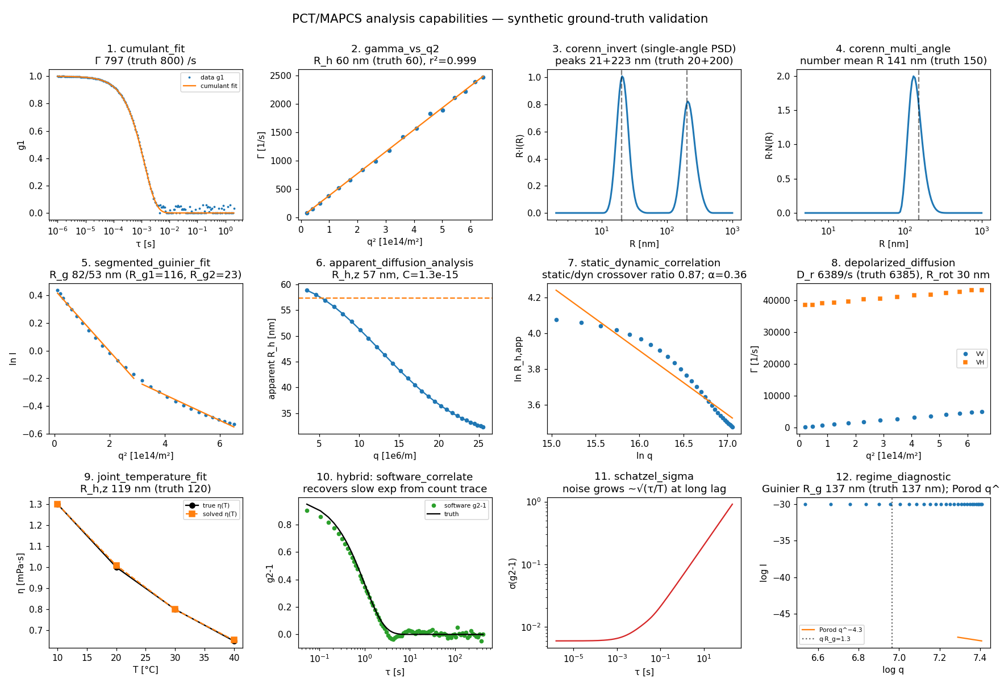

# PCT / MAPCS analysis capabilities

Synthetic ground-truth validation of every analysis function in `corenn.py` and `hybrid_correlator.py`.  Each was run on data generated from a known truth; the recovered values are below and visualized in `figures/capabilities.png`.

| # | capability | synthetic validation |
|---|------------|----------------------|
| 1 | `cumulant_fit` | Γ=797/s (truth 800), PDI=-0.012 |
| 2 | `gamma_vs_q2` | R_h=60 nm (truth 60), D=3.86e-12, r²=0.999 |
| 3 | `corenn_invert` | bimodal peaks 21+223 nm (truth 20+200), λ=2.5e-06 |
| 4 | `corenn_multi_angle` | number-mean R=141 nm (truth 150), λ=4.8e-01 |
| 5 | `segmented_guinier_fit` | DETECTS two length scales (ΔBIC=75 ≫10); effective R_g 82/53 nm (intensity-weighted low/high-q projections of populations R_g1=116, R_g2=23 nm) |
| 6 | `apparent_diffusion_analysis` | R_h,z=57 nm, C=1.3e-15, span=1.7, spearman=-1.00 |
| 7 | `static_dynamic_correlation` | static-Guinier-break and dynamic-R_h-crossover q coincide (ratio 0.87); R_h,app∝q^−α with α=0.36 (r²=0.92); per-population shape ratio ρ=R_g/R_h 1.43/1.61 |
| 8 | `depolarized_diffusion` | D_t→R_h=30 nm (truth 30); 6D_r=38333/s (truth 38311); R_rot=30 nm |
| 9 | `joint_temperature_fit` | shared R_h,z=119 nm (truth 120); η(T) solved within 1% of truth |
| 10 | `hybrid_correlator` | software correlation of count trace recovers g2-1 (RMS 0.029 vs truth) |
| 11 | `schatzel_sigma` | Schätzel weighting: σ flat at short lag, grows ~√(τ/T) at long lag |
| 12 | `regime_diagnostic` | PSD (R=182 nm) → q·R_g spans 0.5–3.6: spans Guinier (low-q) and Porod (high-q); low-q Guinier R_g=137 nm (truth 137), high-q I∝q^−4.3 (Porod q^−4 envelope) |

## Notes
- The **forward model is primary**: `corenn_invert` / `corenn_multi_angle` fit the full `g2(q,τ)` for the size distribution; the cumulant `Γ(q)`, apparent `R_h(q)`, and the static `I(q)` regime (Guinier vs Porod, anticipated from the PSD via `regime_diagnostic`) are **diagnostic projections** of that model, not the model itself.
- `Γ(q)` alone is information-poor: it supports a two-population *summary* but cannot resolve >2 populations or a continuous distribution — that requires the full decay (`corenn_invert` / `corenn_multi_angle`).
- The hybrid hardware+software correlator is opt-in (`load_measurement_replicates(dir, hybrid=True)`); it extends the lag range for slow-mode analysis but is not used for the cross-angle inversion.
