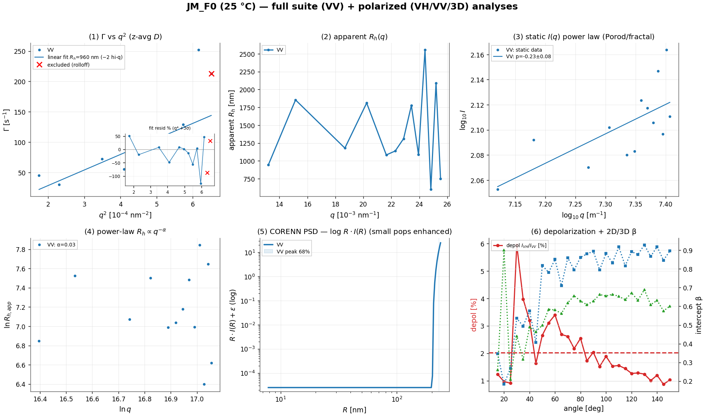
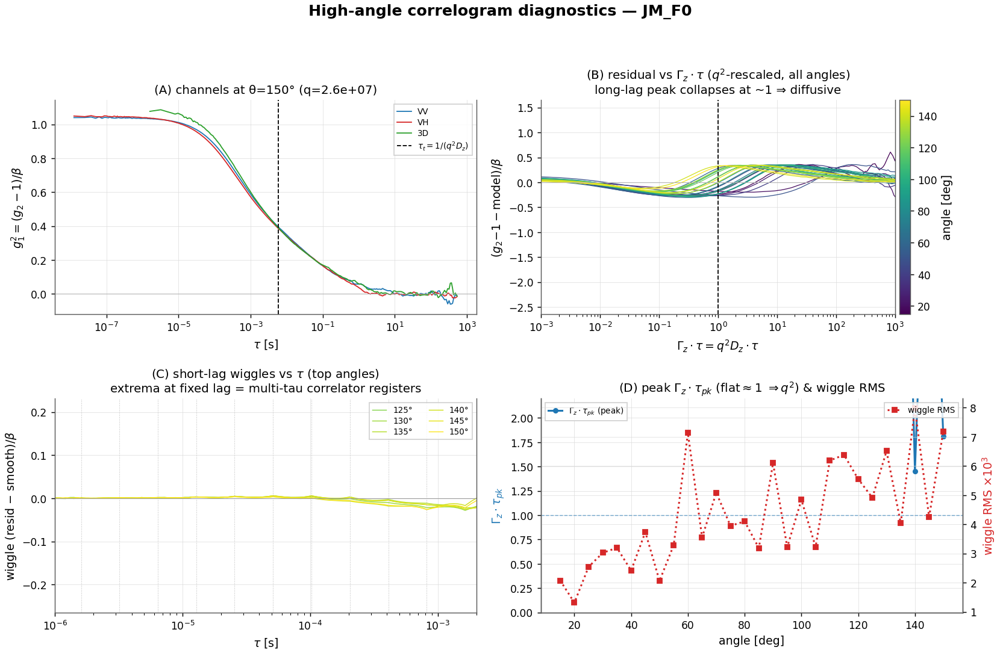
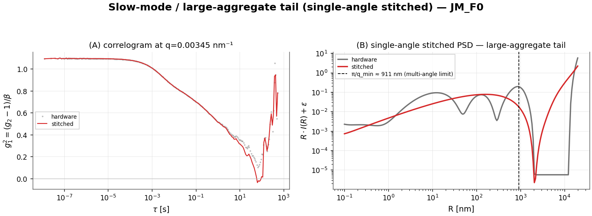
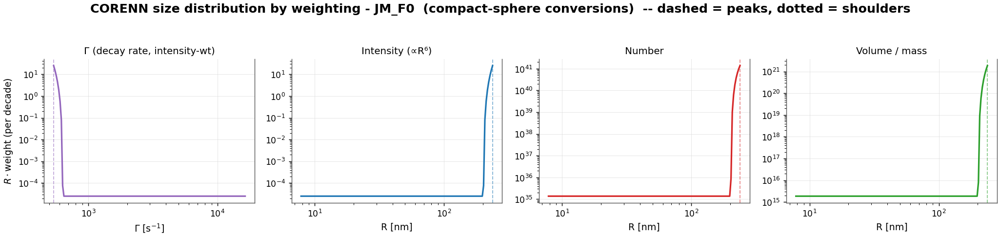
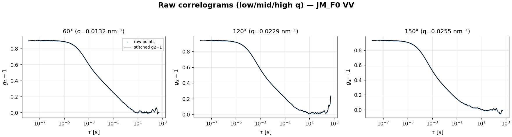
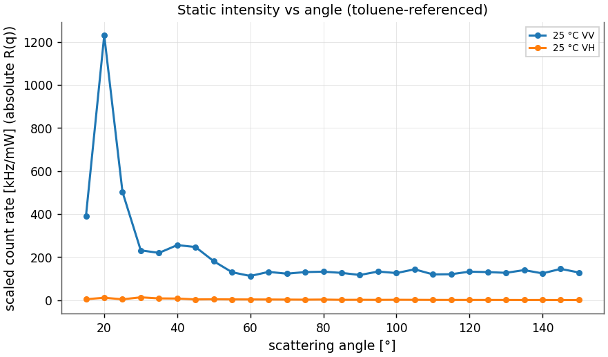

# JM_F0 (25 °C) — provisional polarized DLS analysis report

## Executive Summary

**Dataset.** Multi-angle PCS at 25 °C: 28 angles (15–150°), three measurements per angle — depolarized VH, polarized VV (both 2D pseudo-cross), and 3D modulated cross. The full suite runs on VV.

**Main result.** A large, polydisperse, weakly optically anisotropic aggregate sample. The z-average R_h is **938 nm** but at/beyond the resolution limit — the angle bootstrap spans 501–2452 nm and the CORENN peak is rail-pinned at the largest resolvable size, so the size is a **lower bound**, not a measurement. The data are deep in the **Porod regime**, so **ρ = R_g/R_h is not determined**. VV and VH report the same translational dynamics; rotational diffusion is below resolution; the 2.0% depolarization quantifies a small optical anisotropy.

**Confidence.** The z-average r_h carries replicate/angle bootstrap intervals; leave-one-angle-out cv gives predictive r²=0.135; the corenn inversion converged but the gcv minimum is at a λ-grid boundary.

**Assumption-sensitive.** Viscosity, refractive index, q-from-angle calibration, the toluene/absolute-intensity reference, the assumed sphere form factor, and the CORENN regularization all enter the reported sizes; see the Assumption Register.

**Recommended next action.** measure at lower angle / use a longer wavelength to bring the µm aggregates inside the resolvable window; confirm solvent η and the toluene reference.

> **Provisional flags:** z-average size is at/beyond the q-resolution limit (lower bound); single repetition per angle — no replicate-repeatability CI (only the angle/model bootstrap); toluene/absolute-intensity reference not confirmable from the export; sphere form factor assumed (ρ not determined); ~2% depolarization implies weak anisotropy.

## Summary Table

| quantity | value |
|---|---|
| angles × channels | 28 × (VH, VV, 3D) |
| z-average R_h [68%/95% CI] | 908 [68% 693–1357; 95% 501–2452] nm |
| shape ρ = R_g/R_h | not determined (Porod regime) |
| apparent R_h low→high q | 1399→1421 nm |
| static power-law I∝q^−p | p=-0.2 (r²=0.47) |
| Γ(q²) predictive R² (LOO-CV) | 0.135 (in-sample 0.379) |
| CORENN eff.DOF / cond | 12/24, κ=2e+12 |
| CORENN multi-angle PSD | 231 nm (100%) |
| CORENN peak [68%/95% CI, bootstrap] | 231 [68% 231–231; 95% 231–231] nm |
| 6 D_r (VH−VV intercept) | -8.7 /s (not credibly resolved) |
| depolarization ratio | 2.02 % |
| mean intercept β (2D / 3D) | 0.74 / 0.58 |

## Consolidating Figures

*Consolidating figure: 5 suite panels (VV) plus depolarization ratio and 2D/3D coherence β vs angle (raw-derived).*

## Primary Model Results

**Channel identification.** Per angle, the two pseudo-cross measurements are VH (low count rate) and VV (high count rate); the third is 3D modulated cross. q is recomputed from the angle. The full suite runs on the polarized VV channel.

**Step 1 — per-angle cumulants → Γ(q) (VV).** A 2nd-order cumulant on the initial decay (g1_min=0.6) gives the decay rate at each angle; 13 angles are kept. 15 of 28 angles are rejected because the cumulant apparent R_h exceeds the slow-mode acceptance threshold (~3π/q_low, here >2733 nm) — i.e. they are dominated by an unresolvably slow aggregate mode / noise.

**Step 2 — Γ vs q² (apparent diffusion).** Γ vs q² is linear over the bulk but the **2 highest-q angle(s) roll off** (Γ plateaus/drops at q = 0.0252, 0.0255 nm⁻¹ — weak signal, number fluctuations, and residual multiple scattering at high angle), so they are excluded. A straight-line fit Γ = c + D·q² to the remaining **11 of 13 angles** (q ≤ 0.0248 nm⁻¹, σ from homoscedastic (residual-estimated)) gives the **apparent diffusion coefficient D = 2.555e-13 ± 3.8e-14 m²/s → R_h = 960 nm** (vs 938 nm for the all-angle fit that includes the rolloff). D_app then varies with q for a polydisperse sample (quantified next).

**Step 3 — apparent R_h(q) (polydispersity).** apparent R_h is roughly flat with q, from **1399 nm** (low q) to **1421 nm** (high q) (curvature C=5.44e-16, Spearman -0.06); mean PDI 0.89 — a polydisperse population with no single dominant length scale.

**Step 4 — static intensity I(q), regime from the PSD.** The CORENN PSD gives dominant scatterers of R ≈ 231 nm (R_g ≈ 179 nm, sphere-derived from the PSD radius — no Guinier regime is reached, so this is a model estimate, not a measured R_g), so q·R_g spans 2.4–4.6 across the angles → **form-factor / Porod (q·R ≳ π throughout)**. On the 13 point contiguous lower-q scaling window (q=0.0132–0.0255 nm⁻¹): a near-flat / noisy high-q intensity (I ∝ q^+0.2), so no clean Porod slope (r²=0.470) (reported as diagnostic only).

**Step 5 — dynamic q-dependence.** The apparent size follows a power law R_h,app ∝ q^−α with α=0.03 (r²=0.00) — a compact descriptor of the breadth of the distribution (α→0 monodisperse, α→1 fully scale-free).

**Step 6 — CORENN multi-angle PSD (forward model).** The joint inversion of the resolvable angles, on a radius grid bounded by dynamic observability plus the static q-window (PSD grid 8–238 nm, upper bound set by static_q) and the main-relaxation lag window (λ=1.0e+03), recovers one q-consistent intensity size distribution: peak(s) at **231 nm (100%)** — this peak sits at the PSD upper observability bound (~238 nm); the true material may extend beyond the measured lag/q window, so treat it as an unresolved slow-tail / lower-bound signature rather than a resolved peak.. An 20-angle bootstrap of the inversion puts the primary peak at 231 nm [68% 231–231; 95% 231–231 nm].

## Static Regime And Shape

The CORENN PSD anticipates which static regime each angle probes (Guinier where q·R_g < 1.3, Porod where q·R ≳ π). When a **valid Porod slope** exists, its exponent informs the form-factor / morphology model (q^−4 a smooth sphere; 3<p<4 a surface fractal, D_s=6−p; p≈3 a rough-surface or branched network; 2≤p<3 a mass-fractal / branched aggregate, D=p; p≈2 a coil; p≈1 a rod). ρ = R_g/R_h is the model-independent shape check (sphere ≈ 0.78, coil ≈ 1.5, rod ≳ 2), determined only when a static Guinier R_g exists.

| condition | q·R_g span | regime | static fit | implied morphology | ρ = R_g/R_h |
|---|---|---|---|---|---|
| 25 °C | 2.4–4.6 | form-factor / Porod (q·R ≳ π throughout) | flat/rising I∝q^+0.2 (no clean slope) | — | not determined |

**Particle model.** The PSD assumes a homogeneous-sphere form factor. No valid Porod slope and ρ is **not independently determined** (no Guinier regime, or a low-q structure factor), so the sphere assumption is not confirmed; treat the PSD radii as model-dependent.

## Error Propagation And Sensitivity

Headline R_h and the PSD peak carry bootstrap intervals (ρ where determined). The **replicate** bootstrap is measurement repeatability; the **angle/model** bootstrap is robustness to angle selection — the dominant term for polydisperse samples.

| condition | R_h replicate 68% | R_h angle/model 68% | PSD peak 68% | ρ 68% |
|---|---|---|---|---|
| 25 °C | — | 693–1357 nm | 231–231 nm | — |

**Systematic sensitivity (not included in the intervals above).** R_h = kT/(6πηD) scales inversely with viscosity, so a viscosity error propagates linearly into R_h; the q calibration (scattering angle + refractive index) shifts every q-dependent quantity; the absolute-intensity (toluene) scale sets the SLS magnitude; and the assumed sphere form factor biases the PSD radii for non-spherical particles. See the Assumption Register.

## Fit Quality And Model Adequacy

Beyond r²: a hold-out cross-validation (predictive R²), a residual-structure test (runs / lag-1 autocorrelation — structured residuals flag model inadequacy even at high r²), and the CORENN inversion's convergence and conditioning.

| condition | Γ-vs-q² R² (in / CV) | Γ resid | CORENN g2 resid | CORENN: conv / GCV / κ / eff-DOF |
|---|---|---|---|---|
| 25 °C | 0.379 / 0.135 | **structured** | **structured** | yes / boundary / κ=2e+12 / 12/24 |

*Structured Γ-vs-q² residuals reflect the known polydispersity curvature (the single slope is a summary, not the model); structured CORENN g2 residuals flag form-factor / single-distribution imperfection. A predictive CV R² well below the in-sample R² indicates over-fitting / poor extrapolation across angles.*

*Conditioning: κ ≈ 2e+12 means the inversion is **severely ill-conditioned** (~12 of ~16 double-precision digits lost), so the recovered distribution is fixed by the regularization, not the data alone — reinforcing the modality caveat. The eff-DOF/n_basis above is the **multi-angle** inversion's data-supportable complexity; it is a different inversion from the single-angle stitched one whose eff-DOF (~5–6) appears in the size_max diagnostic.*

## Sample Synthesis

What the independent observables imply about the sample as a colloid — derived only from the scattering data above, with the inversion caveats carried through:

**Physical picture.** The scattering is dominated by ~**238 nm** objects (intensity-weighted); by number the population centres near ~**238 nm**, and the z-average R_h is 938 nm — best read as one broad, polydisperse distribution spanning these scales rather than well-separated species (see the size-distribution-by-weighting and size_max sections).

**Hydrodynamic shape (Guinier–Porod → Stokes–Einstein).** The static slope identifies the dominant scatterer as **a sphere (assumed)**, so the geometry-matched Stokes–Einstein relation is **D = kT/(6πηR)** — the radius R = R_h is **960 nm**. No resolved Porod slope, so the sphere form is assumed.

**Primary unit.** The number-weighted mode (~238 nm) is the smallest resolved scatterer — plausibly the primary particle or smallest aggregate. A depolarized signal (I_VH/I_VV ≈ 2.0%) shows the scatterers are optically anisotropic (plate- or rod-like primaries), but rotational diffusion is not credibly resolved, so an independent shape/size from rotation is not available here.

**Not determinable from this angular range.** The lowest q still has q·R_g ≈ 2.4 (> 1.3), so the **Guinier regime is never reached**: an independent radius of gyration, an absolute molar mass / aggregation number, and ρ = R_g/R_h cannot be measured here — only inferred. Reaching them needs q ≲ 0.00727 nm⁻¹ (smaller scattering angles, low-q SLS, or SAXS).

**Caveats that bound these conclusions.** *(1) Dilute limit / S(q):* the analysis assumes single-particle scattering; if the suspension is not dilute, a low-q structure factor (interparticle correlations or incipient gelation) can bias the Porod/fractal slope and the apparent sizes — a dilution series would test it. *(2) Inversion dependence:* the modes and the aggregation number inherit the ill-posedness and size_max / λ / form-factor sensitivity documented in the size-distribution sections. *(3) Stability:* this is a single time-point of a system that can aggregate or sediment; a repeat / time-resolved run (or checking the count rate for drift across the angle scan) is needed to establish the distribution is stationary.

**Consistency across observables.** The broad dynamic distribution (mean PDI 0.89, apparent R_h falling with q) matches the polydisperse population inferred from the static slope. No single observable here is contradicted by another — the picture is one broad, anisotropic, polydisperse population rather than a set of distinct species.

## Mode-Specific Diagnostics

### Rotational diffusion (depolarized VV/VH)

Polarized and depolarized translational diffusion: D_t(VV)=2.04e-13, D_t(VH)=2.13e-13 m²/s. The VH−VV intercept difference 6D_r = -8.7 /s makes rotation **not credibly resolved**: the intercept is within noise. These are µm-scale aggregates, for which whole-particle rotation (D_r ∝ 1/R³) is far too slow to measure.

### Optical anisotropy (depolarization ratio)

The intensity ratio I_VH/I_VV averages **2.02 %** (0.87–5.95 % across angles) — a small but measurable optical anisotropy.

### 2D vs 3D cross-correlation (multiple scattering)

The 3D modulated cross-correlation suppresses multiple scattering. The coherence factor (intercept β) averages 0.74 for 2D VV vs 0.58 for 3D; their angular dependence (consolidating panel 6) flags where multiple-scattering / geometry corrections matter.

### High-angle correlogram diagnostics (µs–ms ripples)

The high-angle single-exponential residual contains **two distinct features** that separate by their q-scaling: a **long-lag peak** that shifts to shorter lag with increasing angle, and **short-lag wiggles** that barely move. Panels (B)–(D) tell them apart across all angles.

*Reading the panels.* **(A)** VV/VH/3D at the top angle (a faster VH would be the rotational signature Γ_VH=q²D_t+6D_r; a VV-vs-3D split flags modulation / multiple scattering). **(B)** residual vs the q²-rescaled lag Γ_z·τ — a feature that **collapses onto Γ_z·τ≈1** for every angle is a genuine diffusive relaxation. **(C)** the short-lag wiggle component vs *absolute* τ — extrema that line up at **fixed lag** (dotted: the multi-tau correlator register boundaries) are instrumental, not q-dependent dynamics. **(D)** trends: a flat Γ_z·τ_pk ≈ 1 confirms the peak scales as q²; the wiggle RMS grows as the signal weakens at high q.

*This sample — the two features separated across all 28 angles:* **(1) the long-lag peak** sits at Γ_z·τ_pk ≈ 3.96 and stays roughly constant across angles (panel D), i.e. it tracks τ_pk = 1/(q²D_z) ∝ 1/q² and collapses onto a single curve under q² rescaling (panel B) — a **genuine diffusive multi-mode / polydispersity** deviation (the broad relaxation-time distribution of the sample), strongest at high q. **(2) the short-lag wiggles** pin to *fixed* absolute lags (≈ 13, 26, 51, 102 µs), independent of angle and locked to the multi-tau correlator's register boundaries (panel C), with the amplitude growing ≈3× from low to high angle as the signal weakens — a **correlator / instrumental artifact**, not sample dynamics.

Channel check (A): at the top angle Γ_VH/Γ_VV = 1.12, i.e. VH decays faster (a rotational signature *if* not VH shot noise); but the depolarized channel is weak (I_VH/I_VV ≈ 2.0 %) so Γ_VH is noise-limited.

### Slow-mode / large-aggregate tail (single-angle stitched)

The multi-angle intensity PSD is q-resolution-limited: its R^6-weighted q->0 representation, coupled through the sphere form factor, edge-piles for R ≳ π/q_min ≈ **911 nm**. A *single-angle* CORENN inversion of the gap-aware **stitched** correlogram (clean long-lag pooled over the full run, τ_max 537→537 s) instead recovers the slow diffusive modes directly from the decay-rate spectrum — with a data-bounded amplitude, so it resolves the large-aggregate tail where the multi-angle PSD cannot.

At the lowest angle (q=0.00345 nm⁻¹) the stitched inversion places **72% of the intensity beyond π/q_min**, but it **piles at the radius-grid edge (~20 µm)**: the aggregates here are at/beyond even single-angle resolution, so this is a **lower bound** on a large-aggregate population (a genuinely slow diffusive mode), not a measured size — consistent with this sample sitting at the q-resolution limit.

### Size distribution by weighting — continuous summary, then apparent modes

DLS recovers a size distribution by an **ill-posed Laplace inversion**: many different distributions — a smooth continuum or a set of discrete modes — reproduce the measured correlation function equally well within noise, and the regularized inversion (CORENN) returns just one of them, fixed by its smoothness penalty, radius grid, and form-factor assumption. The number and sharpness of peaks are therefore properties of the inversion, not facts the data establish on their own. The report gives **two views**: (1) assumption-light continuous percentiles, and (2) the inversion's apparent modes/shoulders, flagged as inversion-dependent and trustworthy only where they survive the size_max / λ sensitivity tests. CORENN returns the *same* inversion under every weighting (the vendor's Γ / Intensity / Number / Volume tabs); re-weighting only relocates and re-weights the features.

**Γ (decay-rate) view — the rawest signal (figure panel 1).** Before any size model, the dominant intensity component relaxes at Γ ≈ **540 s⁻¹** (relaxation time τ = 1/Γ ≈ **1.85 ms**) at the reference angle; the size columns below are this spectrum mapped through Stokes–Einstein Γ = k_BT q²/(6πηR).

**Continuous-distribution summary (percentiles; no modes assumed).** The assumption-light description — percentiles of the recovered distribution, robust to how it is partitioned into modes. Intensity is narrow (dominated by the largest scatterers); number-weighting (÷R⁶) strongly amplifies the inverted PSD's small-R end, so its percentiles are the least certain.

| Weighting | D10 (nm) | D50 (nm) | D90 (nm) | D_g (nm) | σ_g (GSD) | span | log-skew |
|---|---:|---:|---:|---:|---:|---:|---:|
| Intensity (∝R⁶) | 221 | 232 | 237 | 231 | 1.03 | 0.07 | -0.91 |
| Number (sphere, R⁶) | 219 | 231 | 237 | 230 | 1.03 | 0.07 | -0.78 |
| Volume (sphere, R³) | 220 | 231 | 237 | 230 | 1.03 | 0.07 | -0.85 |

**Modality caveat — read the next table as inversion fine structure.** The Laplace inversion is ill-posed: a smooth continuum and a set of discrete modes can fit the same g₂ within noise, so the number and sharpness of peaks depend on the regularization (λ), the radius grid / size_max, the spline basis, and the sphere form factor — none of which the data uniquely fix. The inversion carries ≈ **12 spline degrees of freedom** — ample latitude to place peaks on a continuum. **Treat the apparent peaks/shoulders below as fine structure of this particular inversion — not established sub-populations — unless they are stable under the size_max / λ sensitivity checks and reproducible across replicates.**

#### Apparent modes & shoulders (CORENN fine structure — inversion-dependent)

| Weighting | Comp. | Peak R (nm) | ⟨R⟩ (nm) | Median (nm) | Fraction | GSD | log-skew |
|---|---|---:|---:|---:|---:|---:|---:|
| Intensity (∝R⁶) | 1 (edge) | ≥238 | 231 | 232 | 100% | 1.03 | -0.91 (tail → small R) |
| Number (sphere, R⁶) | 1 (edge) | ≥238 | 230 | 231 | 100% | 1.03 | -0.78 (tail → small R) |
| Volume (sphere, R³) | 1 (edge) | ≥238 | 230 | 231 | 100% | 1.03 | -0.85 (tail → small R) |

*An **edge** component piles against the radius-grid bound (≤ small-R or ≥ large-R edge) — it is unresolved, so its size is a bound only and its ⟨R⟩/median/skew are not reliable. This is typical when number/volume weighting (÷R⁶, ÷R³) amplifies the inverted PSD's small-R floor.*

The intensity distribution is led by a peak at **238 nm** (100% of scattered light, tail → small R); under number weighting the dominant component is at **238 nm** — the *same* data, modes relocated and re-weighted by the R-power, which is why no single mean describes it.

*Volume/Number assume compact spheres (V∝R³); no mass-fractal correction is applied (the static slope is consistent with a compact / surface-fractal object, D_f≈3).*

## Data Inventory

One row per analysed condition (per-angle detail is in Per-Curve Fit Results).

| condition | channel | n angles (kept/total) | angle range | q range [nm⁻¹] | T [K] | scaled count rate [kHz/mW] | reps | missing meta |
|---|---|---|---|---|---|---|---|---|
| 25 °C | VV | 13/28 | 15–150° | 0.0132–0.0255 | 298.2 | 113–1230 | 0 | 0 |

## Raw Correlograms

*Raw VV correlograms at low/mid/high q: the stitched multi-tau correlation (black) over the semi-transparent raw points.*

## Count Rates And Static Intensities (absolute, toluene-referenced)

*Scaled count rate (absolute Rayleigh ratio) vs angle, VV and VH channels (raw data).*

## Per-Curve Fit Results

### Per-curve fits — 25 °C (VV)

Per-angle 2nd-order cumulant on the leading decay (g1_min=0.6); R_h,app = kT q²/(6πη Γ).

| angle [°] | q [nm⁻¹] | Γ [1/s] | μ₂ | PDI | β | R_h,app [nm] | reps | accepted |
|---|---|---|---|---|---|---|---|---|
| 60 | 0.0132 | 45.4 | 1.8e+03 | 0.88 | 0.851 | 943 | 1 | yes |
| 70 | 0.0152 | 30.4 | 8.1e+02 | 0.88 | 0.859 | 1854 | 1 | yes |
| 90 | 0.0187 | 72.6 | 4.6e+03 | 0.88 | 0.894 | 1179 | 1 | yes |
| 100 | 0.0202 | 55.5 | 2.7e+03 | 0.87 | 0.883 | 1811 | 1 | yes |
| 110 | 0.0216 | 106.0 | 1.0e+04 | 0.89 | 0.917 | 1083 | 1 | yes |
| 115 | 0.0223 | 106.9 | 1.0e+04 | 0.89 | 0.817 | 1139 | 1 | yes |
| 120 | 0.0229 | 97.8 | 8.5e+03 | 0.88 | 0.893 | 1312 | 1 | yes |
| 125 | 0.0234 | 75.8 | 4.9e+03 | 0.86 | 0.877 | 1776 | 1 | yes |
| 130 | 0.0239 | 129.3 | 1.5e+04 | 0.89 | 0.929 | 1088 | 1 | yes |
| 135 | 0.0244 | 57.2 | 2.8e+03 | 0.85 | 0.867 | 2553 | 1 | yes |
| 140 | 0.0248 | 251.8 | 6.0e+04 | 0.95 | 0.919 | 600 | 1 | yes |
| 145 | 0.0252 | 74.5 | 4.8e+03 | 0.87 | 0.847 | 2091 | 1 | yes |
| 150 | 0.0255 | 212.9 | 4.3e+04 | 0.94 | 0.896 | 750 | 1 | yes |

## Rejected Data And Failure Diagnostics

**25 °C (VV)** — 15 angle(s) rejected:

| angle [°] | q [nm⁻¹] | apparent R_h [nm] | reason |
|---|---|---|---|
| 15 | 0.00345 | 11535 | apparent R_h beyond resolvable window (>2733 nm) |
| 20 | 0.00459 | 123393 | apparent R_h beyond resolvable window (>2733 nm) |
| 25 | 0.00572 | 13693 | apparent R_h beyond resolvable window (>2733 nm) |
| 30 | 0.00684 | 5948 | apparent R_h beyond resolvable window (>2733 nm) |
| 35 | 0.00794 | 5979 | apparent R_h beyond resolvable window (>2733 nm) |
| 40 | 0.00904 | 20765 | apparent R_h beyond resolvable window (>2733 nm) |
| 45 | 0.0101 | 3756 | apparent R_h beyond resolvable window (>2733 nm) |
| 50 | 0.0112 | 98364 | apparent R_h beyond resolvable window (>2733 nm) |
| 55 | 0.0122 | 7060 | apparent R_h beyond resolvable window (>2733 nm) |
| 65 | 0.0142 | 4949 | apparent R_h beyond resolvable window (>2733 nm) |
| 75 | 0.0161 | 3565 | apparent R_h beyond resolvable window (>2733 nm) |
| 80 | 0.017 | 2806 | apparent R_h beyond resolvable window (>2733 nm) |
| 85 | 0.0178 | 7773 | apparent R_h beyond resolvable window (>2733 nm) |
| 95 | 0.0195 | 7377 | apparent R_h beyond resolvable window (>2733 nm) |
| 105 | 0.021 | 5302 | apparent R_h beyond resolvable window (>2733 nm) |

## Assumption Register

| assumption | value | source | affects | sensitivity checked? | comment |
|---|---|---|---|---|---|
| wavelength | 632.8 nm | instrument default | q, D, R_h | no | — |
| refractive index | 1.33 | assumed aqueous | q | no | replace with measured |
| viscosity | 0.89 mPa·s | recorded export / fallback 0.89 mPa·s | R_h | yes | verify solvent and temperature |
| q source | recalculated from angle | pipeline | all q-dependent fits | no | vendor 'Scattering vector [1/nm]' column is mislabelled (values are 1/m); q recomputed from angle, reported in nm⁻¹ |
| static scale | absolute (toluene-referenced) — assumed, unverified | LSII toluene reference | SLS, R_g | no | toluene reference not confirmable from parsed export |
| form factor | homogeneous sphere (RGD) | pipeline | PSD radii, ρ check | yes | flag if ρ≠0.78 or depolarization present |
| cumulant g1_min | 0.6 | pipeline config | Γ, PDI | yes | leading-decay window |
| PSD radius grid | 8–238 nm | dynamic observability + static q guardrail | PSD peaks | yes | upper=min(dynamic 20108 nm, static 238 nm, default 5000 nm); limiting=static_q; tau_max=0.1 s, min field decay=0.223 |
| PSD basis | 24 B-spline control points | pipeline config | PSD smoothness | yes | — |
| regularization | GCV-selected λ=1.0e+03 | pipeline | PSD width | yes | interior minimum required |
| baseline | free per fit (CORENN); leading-decay cumulant | pipeline config | Γ, PSD | yes | — |

## Quality Gates

Provisional report: **10 PASS, 2 WAIVE, 0 FAIL** of 12.

| gate | status | note |
|---|---|---|
| q physically plausible / reproducible from angle | **PASS** | q recomputed from angle (vendor q column mislabeled 1/nm) |
| viscosity not a placeholder | **PASS** | recorded value used |
| fit bounds stated for every fit | **PASS** | cumulant g1_min=0.6; CORENN tau_max=0.1s, Rmax=238 nm (static_q) |
| rejected curves/angles listed | **PASS** | 15 rejected, tabulated |
| residual-structure test reported (not r² alone) | **PASS** | runs test + lag-1 autocorrelation |
| headline R_h carries a bootstrap CI | **PASS** | angle/model bootstrap (no angle has ≥2 replicates, so no repeatability CI) |
| hold-out cross-validation reported | **PASS** | leave-one-angle-out |
| CORENN converged + well-posed regularization | **WAIVE** | converged=True, GCV interior=False, κ=2e+12 |
| static scale confirmed absolute | **WAIVE** | toluene reference assumed (LSII default), not confirmable from parsed export |
| PSD basis (intensity/volume/number) stated | **PASS** | intensity-weighted primary, conversions noted |
| ρ = R_g/R_h and particle model stated | **PASS** | not determined; sphere form factor assumed |
| figure captions state raw vs derived | **PASS** | captions included |

## Metadata

| field | value |
|---|---|
| Report title | JM_F0 (25 °C) — provisional polarized DLS analysis report |
| Data source | data/JM_F0/25C |
| Report generator | reports/jm_f0_report.py (provisional) |
| Analyst / owner | automated pipeline |
| Dataset class | multi-angle, single-temperature, polarized (VH/VV/3D) |
| Channels present | VV |
| Temperatures | 298.2 K |
| Angles | 15–150° (28 per condition) |
| q range | 0.00345–0.0255 nm⁻¹ |
| Replicates | single curve per angle |
| Solvent constants | η per condition (see table); n=1.33, λ=632.8 nm (assumed aqueous) |
| Static scale | absolute (toluene-referenced) — assumed, unverified |
| Particle model | homogeneous sphere (assumed; ρ not determined; depolarization ⇒ weak anisotropy) |
| Primary model | CORENN multi-angle PSD (VV) + depolarized VV/VH model |
| Report limitations | size at/beyond resolution limit; sphere model assumed |

## Reproducibility Appendix

| item | value |
|---|---|
| Command | `python reports/jm_f0_report.py` |
| Environment | python 3.13.5, numpy 2.2.5 |
| Git commit (working tree) | 91a3b68 (dirty) |
| Random seeds | bootstraps seed=0 (fixed) |
| Generated files | JM_F0.md, JM_F0.pdf, figures/jm_f0.png, figures/jm_f0_raw.png, figures/jm_f0_slowmode.png, figures/jm_f0_weightings.png, figures/jm_f0_countrate.png, figures/jm_f0_highangle.png, JM_F0.sidecar.json |
