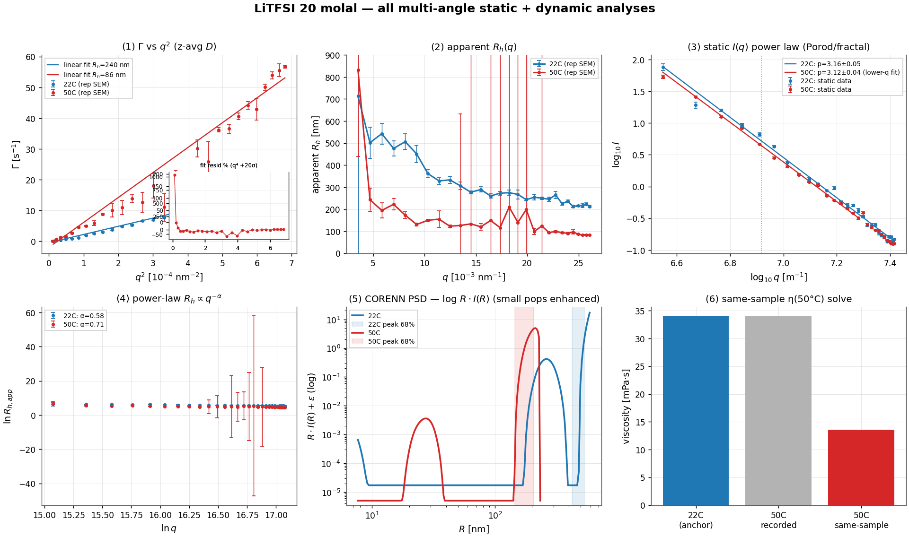
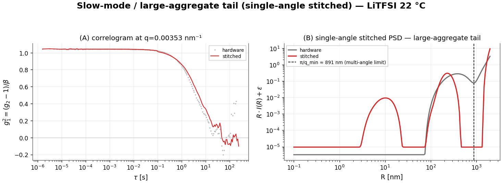
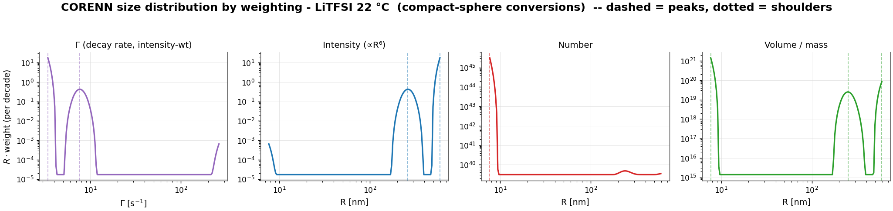
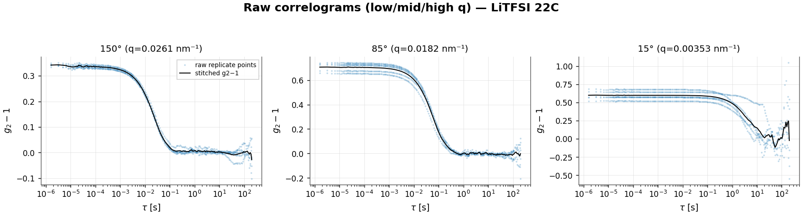
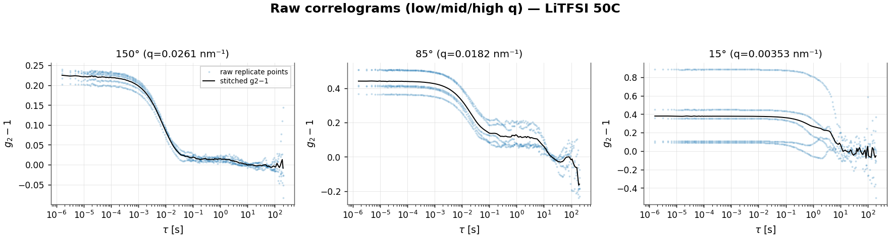
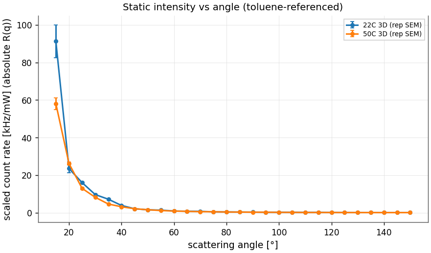

# LiTFSI 20 molal — provisional DLS/SLS analysis report

## Executive Summary

**Dataset.** Water-in-salt electrolyte (LiTFSI, 20 mol/kg) by multi-angle PCS at 22 °C and 50 °C: 28 angles (15–150°), 5 replicates each, 3D-modulated cross-correlation (no polarization channels).

**Main result.** A broadly polydisperse / aggregate-laden electrolyte: a main population of a few hundred nm (z-average R_h ≈ 212 nm at 22 °C, 85 nm at 50 °C) with a slow large-aggregate tail. The data sit in the **Porod regime** at every angle with a slope I ∝ q^−3.2, with the sphere form factor in the PSD assumed, not confirmed; **ρ = R_g/R_h is not determined** (no Guinier regime). The recorded viscosity (fixed 34 mPa·s at both T) is a placeholder; the same-sample solve implies η(50 °C) ≈ 14 mPa·s.

**Confidence.** The z-average r_h carries replicate/angle bootstrap intervals; leave-one-angle-out cv gives predictive r²=0.985; the corenn inversion converged.

**Assumption-sensitive.** Viscosity, refractive index, q-from-angle calibration, the toluene/absolute-intensity reference, the assumed sphere form factor, and the CORENN regularization all enter the reported sizes; see the Assumption Register.

**Recommended next action.** measure the true η(T) of the electrolyte to convert the dynamics to an absolute size; fit a surface-/mass-fractal form factor (the Porod slope rules out a smooth sphere); confirm the toluene reference to lock the SLS scale.

> **Provisional flags:** viscosity is a fixed placeholder (corrected by same-sample solve); toluene/absolute-intensity reference not confirmable from the export; Porod slope q^−3.2 implies a surface-fractal / branched aggregate, not the sphere assumed by the PSD.

## Summary Table

| quantity | 22 °C | 50 °C |
|---|---|---|
| z-average R_h [68% CI] | 212 [206–217] nm | 85 [81–89] nm |
| shape ρ = R_g/R_h | not determined (Porod regime) | 4.31 (rod / stiff / very extended (>1.9)) |
| apparent R_h low→high q | 506→215 nm | 222→84 nm |
| PDI (mean) | 0.30 | 0.68 |
| static power-law I∝q^−p | p=3.2 | p=3.1 |
| Γ(q²) predictive R² (LOO-CV) | 0.985 | 0.926 |
| CORENN eff.DOF / cond | 19/24, κ=1e+14 | 10/24, κ=5e+09 |
| power-law α | 0.58 | 0.71 |
| CORENN multi-angle PSD | 530 nm | 203 nm |
| CORENN peak [68% CI, bootstrap] | 522 [424–538] nm | 193 [145–208] nm |
| implied η(50°C) (same-sample) | — | 14 mPa·s |

## Consolidating Figures

*Consolidating figure: 5 diagnostic/forward-model panels (Γ-vs-q², apparent R_h(q), static I(q) regime, R_h∝q^−α, CORENN PSD) plus the same-sample η(50 °C) solve (raw-derived).*

## Primary Model Results

q = 4πn sin(θ/2)/λ (n=1.36, λ=632.8 nm); the exported 'Scattering vector [1/nm]' column is mislabelled (its values are actually in 1/m), so q is recomputed from the angle and reported in nm⁻¹, spanning **0.00353–0.0261 nm⁻¹**. The size distribution is the **forward model** (CORENN multi-angle); Γ(q), apparent R_h(q), and the static I(q) regime are diagnostic projections.

### 22C (T = 295.1 K, recorded η = 34 mPa·s)

**Step 2 — per-angle cumulants → Γ(q).** A 2nd-order cumulant on the initial decay (g1_min=0.6) gives the decay rate at each angle; 28 angles are kept.

**Step 3 — Γ vs q² (apparent diffusion).** A straight-line fit Γ = c + D·q² over all 28 angles (no high-q rolloff detected) gives the **apparent diffusion coefficient D = 2.653e-14 ± 1.8e-16 m²/s → R_h = 240 nm** (r²=0.987) [replicate/repeatability 68% 210–214; angle/model 68% 206–217 nm]. The fitted intercept c ≈ -0/s is non-zero — a low-q curvature / non-diffusive offset (large-aggregate slow mode, baseline, or weak S(q)) — so read D as the slope of the linear region, not Γ/q². **The fit residuals are structured, not random** (figure inset): they trend systematically with q (Spearman resid–q = +0.49; runs 7 vs ~14 expected) and a q⁴ curvature term is significant at **+20σ** — so even with the rolloff removed, Γ vs q² genuinely **curves upward** — D_app rises with q, the signature of **polydispersity**: the line is a chord and no single slope is *the* diffusion coefficient. The q-dependent apparent size (next step) and the CORENN PSD are the proper description.

**Step 4 — apparent R_h(q) (polydispersity).** apparent R_h falls with q, from **506 nm** (low q) to **215 nm** (high q) (curvature C=1.91e-15, Spearman -0.97); mean PDI 0.30 — a broad / multi-modal population (large-particle tail at low q).

**Step 5 — static intensity I(q), regime from the PSD.** The CORENN PSD gives dominant scatterers of R ≈ 530 nm (R_g ≈ 410 nm, sphere-derived from the PSD radius — no Guinier regime is reached, so this is a model estimate, not a measured R_g), so q·R_g spans 1.4–10.7 across the angles → **form-factor / Porod (q·R ≳ π throughout)**. On the 28 point contiguous lower-q scaling window (q=0.00353–0.0261 nm⁻¹): I ∝ q^−3.16±0.05: a shallow / poorly-resolved power law (r²=0.993) (reported as diagnostic only).

**Step 6 — dynamic q-dependence.** The apparent size follows a power law R_h,app ∝ q^−α with α=0.58 (r²=0.96) — a compact descriptor of the breadth of the distribution (α→0 monodisperse, α→1 fully scale-free).

**Step 7 — CORENN multi-angle PSD (forward model).** The joint inversion of the resolvable angles, on a radius grid bounded by dynamic observability plus the static q-window (PSD grid 8–591 nm, upper bound set by dynamic) and the main-relaxation lag window (λ=4.3e+00), recovers one q-consistent intensity size distribution: peak(s) at **530 nm (100%)** — this peak sits at the PSD upper observability bound (~591 nm); the true material may extend beyond the measured lag/q window, so treat it as an unresolved slow-tail / lower-bound signature rather than a resolved peak.. An 20-angle bootstrap of the inversion puts the primary peak at 522 nm [68% 424–538; 95% 324–567 nm].

### 50C (T = 323.2 K, recorded η = 34 mPa·s)

**Step 2 — per-angle cumulants → Γ(q).** A 2nd-order cumulant on the initial decay (g1_min=0.6) gives the decay rate at each angle; 28 angles are kept.

**Step 3 — Γ vs q² (apparent diffusion).** A straight-line fit Γ = c + D·q² over all 28 angles (no high-q rolloff detected) gives the **apparent diffusion coefficient D = 8.093e-14 ± 4.8e-16 m²/s → R_h = 86 nm** (r²=0.935) [replicate/repeatability 68% 84–87; angle/model 68% 81–89 nm]. The fitted intercept c ≈ -2/s is non-zero — a low-q curvature / non-diffusive offset (large-aggregate slow mode, baseline, or weak S(q)) — so read D as the slope of the linear region, not Γ/q². **The fit residuals are structured, not random** (figure inset): they trend systematically with q (Spearman resid–q = +0.05; runs 3 vs ~12 expected) and a q⁴ curvature term is significant at **+21σ** — so even with the rolloff removed, Γ vs q² genuinely **curves upward** — D_app rises with q, the signature of **polydispersity**: the line is a chord and no single slope is *the* diffusion coefficient. The q-dependent apparent size (next step) and the CORENN PSD are the proper description.

**Step 4 — apparent R_h(q) (polydispersity).** apparent R_h falls with q, from **222 nm** (low q) to **84 nm** (high q) (curvature C=2.34e-15, Spearman -0.86); mean PDI 0.68 — a broad / multi-modal population (large-particle tail at low q).

**Step 5 — static intensity I(q), regime from the PSD.** The CORENN PSD gives dominant scatterers of R ≈ 203 nm (R_g ≈ 157 nm, sphere-derived from the PSD radius — no Guinier regime is reached, so this is a model estimate, not a measured R_g), so q·R_g spans 0.6–4.1 across the angles → **spans Guinier (low-q) and Porod (high-q)**. A Guinier fit on the 5 low-q points (q·R_g < 1.3) gives R_g ≈ **366 nm** (r²=0.94). On the 16 point contiguous lower-q scaling window (q=0.00353–0.0191 nm⁻¹): I ∝ q^−3.12±0.04: a shallow / poorly-resolved power law (r²=0.998) (reported as diagnostic only). The 12 higher-q point(s) are excluded from the exponent because they show systematic departure relative to the lower-q scaling law; physically this is the end of the mass-fractal / form-factor scaling range and/or an additive static background / instrument-floor contribution, not a second Porod law.

**Step 6 — dynamic q-dependence.** The apparent size follows a power law R_h,app ∝ q^−α with α=0.71 (r²=0.69) — a compact descriptor of the breadth of the distribution (α→0 monodisperse, α→1 fully scale-free).

**Step 7 — CORENN multi-angle PSD (forward model).** The joint inversion of the resolvable angles, on a radius grid bounded by dynamic observability plus the static q-window (PSD grid 8–234 nm, upper bound set by dynamic) and the main-relaxation lag window (λ=1.0e-06), recovers one q-consistent intensity size distribution: peak(s) at **203 nm (100%)**. An 20-angle bootstrap of the inversion puts the primary peak at 193 nm [68% 145–208; 95% 98–213 nm].

## Static Regime And Shape

The CORENN PSD anticipates which static regime each angle probes (Guinier where q·R_g < 1.3, Porod where q·R ≳ π). When a **valid Porod slope** exists, its exponent informs the form-factor / morphology model (q^−4 a smooth sphere; 3<p<4 a surface fractal, D_s=6−p; p≈3 a rough-surface or branched network; 2≤p<3 a mass-fractal / branched aggregate, D=p; p≈2 a coil; p≈1 a rod). ρ = R_g/R_h is the model-independent shape check (sphere ≈ 0.78, coil ≈ 1.5, rod ≳ 2), determined only when a static Guinier R_g exists.

| condition | q·R_g span | regime | static fit | implied morphology | ρ = R_g/R_h |
|---|---|---|---|---|---|
| 22C | 1.4–10.7 | form-factor / Porod (q·R ≳ π throughout) | I∝q^−3.16±0.05 (diagnostic only, q=0.00353–0.0261 nm⁻¹) | — | not determined |
| 50C | 0.6–4.1 | spans Guinier (low-q) and Porod (high-q) | Guinier R_g=366 nm | — | 4.31 (rod / stiff / very extended (>1.9)) |

**Particle model.** The PSD assumes a homogeneous-sphere form factor. Where ρ is determined, compare it with the assumed model (sphere ≈ 0.78) and flag departures.

## Error Propagation And Sensitivity

Headline R_h and the PSD peak carry bootstrap intervals (ρ where determined). The **replicate** bootstrap is measurement repeatability; the **angle/model** bootstrap is robustness to angle selection — the dominant term for polydisperse samples.

| condition | R_h replicate 68% | R_h angle/model 68% | PSD peak 68% | ρ 68% |
|---|---|---|---|---|
| 22C | 210–214 nm | 206–217 nm | 424–538 nm | — |
| 50C | 84–87 nm | 81–89 nm | 145–208 nm | 3.72–5.21 |

**Systematic sensitivity (not included in the intervals above).** R_h = kT/(6πηD) scales inversely with viscosity, so a viscosity error propagates linearly into R_h; the q calibration (scattering angle + refractive index) shifts every q-dependent quantity; the absolute-intensity (toluene) scale sets the SLS magnitude; and the assumed sphere form factor biases the PSD radii for non-spherical particles. See the Assumption Register.

## Fit Quality And Model Adequacy

Beyond r²: a hold-out cross-validation (predictive R²), a residual-structure test (runs / lag-1 autocorrelation — structured residuals flag model inadequacy even at high r²), and the CORENN inversion's convergence and conditioning.

| condition | Γ-vs-q² R² (in / CV) | Γ resid | CORENN g2 resid | CORENN: conv / GCV / κ / eff-DOF |
|---|---|---|---|---|
| 22C | 0.987 / 0.985 | **structured** | **structured** | yes / interior / κ=1e+14 / 19/24 |
| 50C | 0.935 / 0.926 | **structured** | **structured** | yes / boundary / κ=5e+09 / 10/24 |

*Structured Γ-vs-q² residuals reflect the known polydispersity curvature (the single slope is a summary, not the model); structured CORENN g2 residuals flag form-factor / single-distribution imperfection. A predictive CV R² well below the in-sample R² indicates over-fitting / poor extrapolation across angles.*

*Conditioning: κ ≈ 1e+14 means the inversion is **severely ill-conditioned** (~14 of ~16 double-precision digits lost), so the recovered distribution is fixed by the regularization, not the data alone — reinforcing the modality caveat. The eff-DOF/n_basis above is the **multi-angle** inversion's data-supportable complexity; it is a different inversion from the single-angle stitched one whose eff-DOF (~5–6) appears in the size_max diagnostic.*

## Sample Synthesis

What the independent observables imply about the sample as a colloid — derived only from the scattering data above, with the inversion caveats carried through:

**Physical picture.** The scattering is dominated by ~**591 nm** objects (intensity-weighted); by number the population centres near ~**8 nm**, and the z-average R_h is 212 nm — best read as one broad, polydisperse distribution spanning these scales rather than well-separated species (see the size-distribution-by-weighting and size_max sections).

**Hydrodynamic shape (Guinier–Porod → Stokes–Einstein).** The static slope identifies the dominant scatterer as **a sphere (assumed)**, so the geometry-matched Stokes–Einstein relation is **D = kT/(6πηR)** — the radius R = R_h is **240 nm**. No resolved Porod slope, so the sphere form is assumed.

**Not determinable from this angular range.** The lowest q still has q·R_g ≈ 1.4 (> 1.3), so the **Guinier regime is never reached**: an independent radius of gyration, an absolute molar mass / aggregation number, and ρ = R_g/R_h cannot be measured here — only inferred. Reaching them needs q ≲ 0.00317 nm⁻¹ (smaller scattering angles, low-q SLS, or SAXS).

**Caveats that bound these conclusions.** *(1) Dilute limit / S(q):* the analysis assumes single-particle scattering; if the suspension is not dilute, a low-q structure factor (interparticle correlations or incipient gelation) can bias the Porod/fractal slope and the apparent sizes — a dilution series would test it. *(2) Inversion dependence:* the modes and the aggregation number inherit the ill-posedness and size_max / λ / form-factor sensitivity documented in the size-distribution sections. *(3) Stability:* this is a single time-point of a system that can aggregate or sediment; a repeat / time-resolved run (or checking the count rate for drift across the angle scan) is needed to establish the distribution is stationary.

**Consistency across observables.** The broad dynamic distribution (mean PDI 0.30, apparent R_h falling with q) matches the polydisperse population inferred from the static slope. No single observable here is contradicted by another — the picture is one broad, polydisperse population rather than a set of distinct species.

## Mode-Specific Diagnostics

### Joint multi-temperature (same sample)

The recorded viscosity is a fixed 34 mPa·s at **both** temperatures — wrong for an electrolyte. The static intensity profile is unchanged with T (power-law exponent 3.2 at 22 °C vs 3.1 at 50 °C), supporting one (T-invariant) scattering structure; the 50 °C diffusion then *implies* the true viscosity:

- D_z(22°C)=2.998e-14, D_z(50°C)=8.209e-14 m²/s; shared R_h,z=212 nm.

- **implied η(50 °C) = 14 mPa·s** (vs recorded 34), ratio η(50)/η(22)=0.40 — the electrolyte thins on heating.

This is a cross-check (dynamics alone cannot separate η(T) from a size change); it is valid only because the *static* R_g is T-invariant.

### Slow-mode / large-aggregate tail (single-angle stitched)

The multi-angle intensity PSD is q-resolution-limited: its R^6-weighted q->0 representation, coupled through the sphere form factor, edge-piles for R ≳ π/q_min ≈ **891 nm**. A *single-angle* CORENN inversion of the gap-aware **stitched** correlogram (clean long-lag pooled over the full run, τ_max 201→241 s) instead recovers the slow diffusive modes directly from the decay-rate spectrum — with a data-bounded amplitude, so it resolves the large-aggregate tail where the multi-angle PSD cannot.

At the lowest angle (q=0.00353 nm⁻¹) the stitched inversion places **82% of the intensity beyond π/q_min**, but it **piles at the radius-grid edge (~2 µm)**: the aggregates here are at/beyond even single-angle resolution, so this is a **lower bound** on a large-aggregate population (a genuinely slow diffusive mode), not a measured size — consistent with this sample sitting at the q-resolution limit.

### Size distribution by weighting — continuous summary, then apparent modes

DLS recovers a size distribution by an **ill-posed Laplace inversion**: many different distributions — a smooth continuum or a set of discrete modes — reproduce the measured correlation function equally well within noise, and the regularized inversion (CORENN) returns just one of them, fixed by its smoothness penalty, radius grid, and form-factor assumption. The number and sharpness of peaks are therefore properties of the inversion, not facts the data establish on their own. The report gives **two views**: (1) assumption-light continuous percentiles, and (2) the inversion's apparent modes/shoulders, flagged as inversion-dependent and trustworthy only where they survive the size_max / λ sensitivity tests. CORENN returns the *same* inversion under every weighting (the vendor's Γ / Intensity / Number / Volume tabs); re-weighting only relocates and re-weights the features.

**Γ (decay-rate) view — the rawest signal (figure panel 1).** Before any size model, the dominant intensity component relaxes at Γ ≈ **3.41 s⁻¹** (relaxation time τ = 1/Γ ≈ **293 ms**) at the reference angle; the size columns below are this spectrum mapped through Stokes–Einstein Γ = k_BT q²/(6πηR).

**Continuous-distribution summary (percentiles; no modes assumed).** The assumption-light description — percentiles of the recovered distribution, robust to how it is partitioned into modes. Intensity is narrow (dominated by the largest scatterers); number-weighting (÷R⁶) strongly amplifies the inverted PSD's small-R end, so its percentiles are the least certain.

| Weighting | D10 (nm) | D50 (nm) | D90 (nm) | D_g (nm) | σ_g (GSD) | span | log-skew |
|---|---:|---:|---:|---:|---:|---:|---:|
| Intensity (∝R⁶) | 287 | 568 | 587 | 514 | 1.31 | 0.53 | -2.34 |
| Number (sphere, R⁶) | 7.7 | 7.9 | 8.3 | 7.9 | 1.03 | 0.08 | +5.42 |
| Volume (sphere, R³) | 7.7 | 8.0 | 256 | 14 | 3.92 | 31.06 | +1.98 |

**Modality caveat — read the next table as inversion fine structure.** The Laplace inversion is ill-posed: a smooth continuum and a set of discrete modes can fit the same g₂ within noise, so the number and sharpness of peaks depend on the regularization (λ), the radius grid / size_max, the spline basis, and the sphere form factor — none of which the data uniquely fix. The inversion carries ≈ **19 spline degrees of freedom** — ample latitude to place peaks on a continuum. **Treat the apparent peaks/shoulders below as fine structure of this particular inversion — not established sub-populations — unless they are stable under the size_max / λ sensitivity checks and reproducible across replicates.**

#### Apparent modes & shoulders (CORENN fine structure — inversion-dependent)

| Weighting | Comp. | Peak R (nm) | ⟨R⟩ (nm) | Median (nm) | Fraction | GSD | log-skew |
|---|---|---:|---:|---:|---:|---:|---:|
| Intensity (∝R⁶) | 1 (edge) | ≥591 | 570 | 572 | 87% | 1.04 | -0.92 (tail → small R) |
|  | 2 | 262 | 264 | 262 | 13% | 1.13 | -0.04 (≈ log-symmetric) |
| Number (sphere, R⁶) | 1 (edge) | ≤7.7 | 7.9 | 7.9 | 100% | 1.03 | +1.03 (tail → large R) |
| Volume (sphere, R³) | 1 (edge) | ≤7.7 | 8.0 | 7.9 | 85% | 1.03 | +0.95 (tail → large R) |
|  | 2 | 250 | 253 | 251 | 10% | 1.13 | +0.07 (≈ log-symmetric) |
|  | 3 (edge) | ≥591 | 567 | 570 | 6% | 1.04 | -0.84 (tail → small R) |

*An **edge** component piles against the radius-grid bound (≤ small-R or ≥ large-R edge) — it is unresolved, so its size is a bound only and its ⟨R⟩/median/skew are not reliable. This is typical when number/volume weighting (÷R⁶, ÷R³) amplifies the inverted PSD's small-R floor.*

The intensity distribution is led by a peak at **591 nm** (87% of scattered light, tail → small R); under number weighting the dominant component is at **7.7 nm** — the *same* data, modes relocated and re-weighted by the R-power, which is why no single mean describes it.

*Volume/Number assume compact spheres (V∝R³); no mass-fractal correction is applied (the static slope is consistent with a compact / surface-fractal object, D_f≈3).*

## Data Inventory

One row per analysed condition (per-angle detail is in Per-Curve Fit Results).

| condition | channel | n angles (kept/total) | angle range | q range [nm⁻¹] | T [K] | scaled count rate [kHz/mW] | reps | missing meta |
|---|---|---|---|---|---|---|---|---|
| 22C | 3D | 28/28 | 15–150° | 0.00353–0.0261 | 295.1 | 0–76 | 28 | 0 |
| 50C | 3D | 28/28 | 15–150° | 0.00353–0.0261 | 323.2 | 0–53 | 28 | 0 |

## Raw Correlograms

*Raw 3D-cross correlograms at low/mid/high q (22C): the stitched multi-tau correlation (black) over the semi-transparent raw replicate points; the point spread is the measurement repeatability.*

*Raw 3D-cross correlograms at low/mid/high q (50C): the stitched multi-tau correlation (black) over the semi-transparent raw replicate points; the point spread is the measurement repeatability.*

## Count Rates And Static Intensities (absolute, toluene-referenced)

*Scaled count rate (absolute Rayleigh ratio) vs angle for both temperatures (raw data).*

## Per-Curve Fit Results

### Per-curve fits — 22C (3D)

Per-angle 2nd-order cumulant on the leading decay (g1_min=0.6); R_h,app = kT q²/(6πη Γ).

| angle [°] | q [nm⁻¹] | Γ [1/s] | μ₂ | PDI | β | R_h,app [nm] | reps | accepted |
|---|---|---|---|---|---|---|---|---|
| 15 | 0.00353 | 0.1 | 8.7e-03 | 0.71 | 0.576 | 713 | 5 | yes |
| 20 | 0.00469 | 0.3 | 4.5e-02 | 0.58 | 0.591 | 502 | 5 | yes |
| 25 | 0.00585 | 0.4 | 4.2e-02 | 0.26 | 0.654 | 543 | 5 | yes |
| 30 | 0.00699 | 0.7 | 3.0e-02 | 0.07 | 0.865 | 476 | 5 | yes |
| 35 | 0.00812 | 0.8 | 7.1e-02 | 0.10 | 0.875 | 506 | 5 | yes |
| 40 | 0.00924 | 1.2 | 1.4e-01 | 0.09 | 0.824 | 451 | 5 | yes |
| 45 | 0.0103 | 1.9 | 8.2e-01 | 0.23 | 0.817 | 361 | 5 | yes |
| 50 | 0.0114 | 2.5 | 8.5e-01 | 0.13 | 0.716 | 329 | 5 | yes |
| 55 | 0.0125 | 3.0 | 3.7e+00 | 0.42 | 0.818 | 333 | 5 | yes |
| 60 | 0.0135 | 3.8 | 4.3e+00 | 0.30 | 0.754 | 306 | 5 | yes |
| 65 | 0.0145 | 4.8 | 2.7e+00 | 0.11 | 0.747 | 277 | 5 | yes |
| 70 | 0.0155 | 5.3 | 7.8e+00 | 0.28 | 0.795 | 289 | 5 | yes |
| 75 | 0.0164 | 6.6 | 8.1e+00 | 0.19 | 0.742 | 260 | 5 | yes |
| 80 | 0.0174 | 7.0 | 1.2e+01 | 0.24 | 0.766 | 273 | 5 | yes |
| 85 | 0.0182 | 7.7 | 1.4e+01 | 0.23 | 0.675 | 275 | 5 | yes |
| 90 | 0.0191 | 8.7 | 2.6e+01 | 0.34 | 0.727 | 267 | 5 | yes |
| 95 | 0.0199 | 10.4 | 2.7e+01 | 0.26 | 0.648 | 243 | 5 | yes |
| 100 | 0.0207 | 10.7 | 3.4e+01 | 0.30 | 0.635 | 254 | 5 | yes |
| 105 | 0.0214 | 11.7 | 4.5e+01 | 0.33 | 0.650 | 250 | 5 | yes |
| 110 | 0.0221 | 12.7 | 6.7e+01 | 0.42 | 0.613 | 245 | 5 | yes |
| 115 | 0.0228 | 12.5 | 7.5e+01 | 0.48 | 0.572 | 265 | 5 | yes |
| 120 | 0.0234 | 15.4 | 9.3e+01 | 0.39 | 0.536 | 225 | 5 | yes |
| 125 | 0.024 | 15.5 | 7.7e+01 | 0.32 | 0.540 | 236 | 5 | yes |
| 130 | 0.0245 | 17.9 | 1.0e+02 | 0.31 | 0.486 | 213 | 5 | yes |
| 135 | 0.025 | 18.4 | 1.1e+02 | 0.33 | 0.492 | 215 | 5 | yes |
| 140 | 0.0254 | 18.9 | 1.5e+02 | 0.42 | 0.511 | 216 | 5 | yes |
| 145 | 0.0258 | 18.9 | 1.2e+02 | 0.33 | 0.399 | 223 | 5 | yes |
| 150 | 0.0261 | 20.3 | 1.3e+02 | 0.31 | 0.340 | 213 | 5 | yes |

### Per-curve fits — 50C (3D)

Per-angle 2nd-order cumulant on the leading decay (g1_min=0.6); R_h,app = kT q²/(6πη Γ).

| angle [°] | q [nm⁻¹] | Γ [1/s] | μ₂ | PDI | β | R_h,app [nm] | reps | accepted |
|---|---|---|---|---|---|---|---|---|
| 15 | 0.00353 | 0.1 | 4.0e-03 | 0.37 | 0.094 | 833 | 5 | yes |
| 20 | 0.00469 | 0.6 | 4.0e-01 | 1.00 | 0.321 | 243 | 5 | yes |
| 25 | 0.00585 | 1.2 | 6.3e-01 | 0.42 | 0.256 | 195 | 5 | yes |
| 30 | 0.00699 | 1.5 | 1.9e+00 | 0.79 | 0.413 | 222 | 5 | yes |
| 35 | 0.00812 | 2.7 | 3.0e+00 | 0.43 | 0.352 | 173 | 5 | yes |
| 40 | 0.00924 | 4.5 | 5.7e+00 | 0.28 | 0.410 | 131 | 5 | yes |
| 45 | 0.0103 | 5.0 | 1.6e+01 | 0.64 | 0.437 | 150 | 5 | yes |
| 50 | 0.0114 | 5.9 | 2.1e+01 | 0.63 | 0.452 | 155 | 5 | yes |
| 55 | 0.0125 | 8.8 | 5.0e+01 | 0.65 | 0.489 | 123 | 5 | yes |
| 60 | 0.0135 | 10.1 | 7.7e+01 | 0.76 | 0.650 | 126 | 5 | yes |
| 65 | 0.0145 | 11.0 | 8.3e+01 | 0.69 | 0.449 | 133 | 5 | yes |
| 70 | 0.0155 | 13.9 | 1.2e+02 | 0.60 | 0.408 | 120 | 5 | yes |
| 75 | 0.0164 | 12.6 | 1.4e+02 | 0.86 | 0.404 | 149 | 5 | yes |
| 80 | 0.0174 | 18.0 | 2.3e+02 | 0.70 | 0.327 | 116 | 5 | yes |
| 85 | 0.0182 | 11.1 | 9.0e+01 | 0.74 | 0.365 | 210 | 5 | yes |
| 90 | 0.0191 | 18.1 | 2.8e+02 | 0.86 | 0.438 | 140 | 5 | yes |
| 95 | 0.0199 | 13.9 | 3.9e+02 | 2.03 | 1.345 | 199 | 5 | yes |
| 100 | 0.0207 | 30.1 | 5.7e+02 | 0.63 | 0.379 | 99 | 5 | yes |
| 105 | 0.0214 | 25.8 | 5.3e+02 | 0.80 | 0.320 | 124 | 5 | yes |
| 110 | 0.0221 | 36.2 | 7.9e+02 | 0.60 | 0.364 | 94 | 5 | yes |
| 115 | 0.0228 | 36.6 | 1.0e+03 | 0.77 | 0.409 | 99 | 5 | yes |
| 120 | 0.0234 | 40.6 | 9.4e+02 | 0.57 | 0.379 | 94 | 5 | yes |
| 125 | 0.024 | 44.2 | 9.8e+02 | 0.50 | 0.319 | 90 | 5 | yes |
| 130 | 0.0245 | 42.9 | 1.3e+03 | 0.69 | 0.308 | 97 | 5 | yes |
| 135 | 0.025 | 50.1 | 1.3e+03 | 0.52 | 0.285 | 87 | 5 | yes |
| 140 | 0.0254 | 54.0 | 1.6e+03 | 0.55 | 0.265 | 83 | 5 | yes |
| 145 | 0.0258 | 55.5 | 1.7e+03 | 0.55 | 0.237 | 83 | 5 | yes |
| 150 | 0.0261 | 56.7 | 1.7e+03 | 0.54 | 0.228 | 84 | 5 | yes |

## Rejected Data And Failure Diagnostics

No angles or curves were rejected.

## Assumption Register

| assumption | value | source | affects | sensitivity checked? | comment |
|---|---|---|---|---|---|
| wavelength | 632.8 nm | instrument default | q, D, R_h | no | — |
| refractive index | 1.36 | aqueous electrolyte, assumed | q | no | replace with measured |
| viscosity | 34.00, 34.00 mPa·s | recorded export (fixed 34 mPa·s) | R_h | yes | fixed at both temperatures — placeholder, corrected by same-sample solve |
| q source | recalculated from angle | pipeline | all q-dependent fits | no | vendor 'Scattering vector [1/nm]' column is mislabelled (values are 1/m); q recomputed from angle, reported in nm⁻¹ |
| static scale | absolute (toluene-referenced) — assumed, unverified | LSII toluene reference | SLS, R_g | no | toluene reference not confirmable from parsed export |
| form factor | homogeneous sphere (RGD) | pipeline | PSD radii, ρ check | yes | flag if ρ≠0.78 or depolarization present |
| cumulant g1_min | 0.6 | pipeline config | Γ, PDI | yes | leading-decay window |
| PSD radius grid | 8–591 nm | dynamic observability + static q guardrail | PSD peaks | yes | upper=min(dynamic 591 nm, static 670 nm, default 5000 nm); limiting=dynamic; tau_max=0.94 s, min field decay=0.223 |
| PSD basis | 24 B-spline control points | pipeline config | PSD smoothness | yes | — |
| regularization | GCV-selected λ=4.3e+00 | pipeline | PSD width | yes | interior minimum required |
| baseline | free per fit (CORENN); leading-decay cumulant | pipeline config | Γ, PSD | yes | — |

## Quality Gates

Provisional report: **11 PASS, 2 WAIVE, 0 FAIL** of 13.

| gate | status | note |
|---|---|---|
| q physically plausible / reproducible from angle | **PASS** | q recomputed from angle (vendor q column mislabeled 1/nm) |
| viscosity not a placeholder | **WAIVE** | same η recorded across temperatures — flagged placeholder |
| fit bounds stated for every fit | **PASS** | cumulant g1_min=0.6; CORENN tau_max=0.94s, Rmax=591 nm (dynamic) |
| rejected curves/angles listed | **PASS** | 0 rejected, tabulated |
| residual-structure test reported (not r² alone) | **PASS** | runs test + lag-1 autocorrelation |
| headline R_h carries a bootstrap CI | **PASS** | replicate + angle/model bootstrap |
| hold-out cross-validation reported | **PASS** | leave-one-angle-out |
| CORENN converged + well-posed regularization | **PASS** | converged=True, GCV interior=True, κ=1e+14 |
| static scale confirmed absolute | **WAIVE** | toluene reference assumed (LSII default), not confirmable from parsed export |
| PSD basis (intensity/volume/number) stated | **PASS** | intensity-weighted primary, conversions noted |
| ρ = R_g/R_h and particle model stated | **PASS** | not determined; sphere form factor assumed |
| multi-temperature size/viscosity ambiguity addressed | **PASS** | same-sample joint-temperature solve reported |
| figure captions state raw vs derived | **PASS** | captions included |

## Metadata

| field | value |
|---|---|
| Report title | LiTFSI 20 molal — provisional DLS/SLS analysis report |
| Data source | data/LiTFSI/20m |
| Report generator | reports/litfsi_report.py (provisional) |
| Analyst / owner | automated pipeline |
| Dataset class | multi-angle, multi-temperature (3D cross-correlation) |
| Channels present | 3D |
| Temperatures | 295.1 K, 323.2 K |
| Angles | 15–150° (56 per condition) |
| q range | 0.00353–0.0261 nm⁻¹ |
| Replicates | 56 angle-sets with ≥2 replicates |
| Solvent constants | η per condition (see table); n=1.36, λ=632.8 nm (aqueous electrolyte, assumed) |
| Static scale | absolute (toluene-referenced) — assumed, unverified |
| Particle model | homogeneous sphere (assumed; ρ not determined to confirm) |
| Primary model | CORENN multi-angle PSD + same-sample joint-temperature solve |
| Report limitations | viscosity placeholder; toluene reference unverified; sphere PSD form factor inconsistent with the Porod slope |

## Reproducibility Appendix

| item | value |
|---|---|
| Command | `python reports/litfsi_report.py` |
| Environment | python 3.13.5, numpy 2.2.5 |
| Git commit (working tree) | 91a3b68 (dirty) |
| Random seeds | bootstraps seed=0 (fixed) |
| Generated files | LiTFSI.md, LiTFSI.pdf, figures/litfsi.png, figures/litfsi_slowmode.png, figures/litfsi_weightings.png, figures/litfsi_raw_22C.png, figures/litfsi_raw_50C.png, figures/litfsi_countrate.png, LiTFSI.sidecar.json |
