# SISV_1% polymer (THF/DOX 7:3) — provisional DLS analysis report

## Executive Summary

**Dataset.** Polymer in THF/dioxane by multi-angle PCS across 7 temperatures (11.5–30.5 °C); each is a MAPCS experiment (27 angles × {VH,VV,3D}, 5 replicates). The full suite runs on VV at every temperature.

**Main result.** A narrow, ~120 nm, nearly optically isotropic polymer. The z-average R_h appears to fall 139→106 nm over 11.5→30.5 °C, but this is mostly the **fixed-viscosity artifact** (η recorded as a constant 0.47 mPa·s); the same-sample solve implies the true η drops ~24% so the size is essentially T-independent. PDI stays ~0.26 and the predictive CV R² is ~1.0 (clean monodisperse). **ρ = R_g/R_h is not determined** (low-q structure factor, not a Guinier R_g); the static intensity shows a weak transition near 15–22 °C.

**Confidence.** The z-average r_h carries replicate/angle bootstrap intervals; leave-one-angle-out cv gives predictive r²=1.000; the corenn inversion converged.

**Assumption-sensitive.** Viscosity, refractive index, q-from-angle calibration, the toluene/absolute-intensity reference, the assumed sphere form factor, and the CORENN regularization all enter the reported sizes; see the Assumption Register.

**Recommended next action.** supply the true η(T) of THF/dioxane to remove the apparent-shrinkage artifact; confirm the toluene reference to lock the SLS scale.

> **Provisional flags:** viscosity is a fixed placeholder at all T (apparent R_h(T) is mostly artifact); toluene/absolute-intensity reference not confirmable from the export; sphere form factor assumed (ρ not determined — low-q structure factor).

## Summary Table

| T [°C] | R_h,z [68% CI nm] | CV R² | PDI | α | CORENN peak | I_VV | depol [%] | η/η_lo |
|---|---|---|---|---|---|---|---|---|
| 11.5 | 139 [139–140] | 1.000 | 0.25 | -0.13 | 157 nm | 174 | 0.033 | 1.00 |
| 15.0 | 132 [132–132] | 1.000 | 0.22 | -0.11 | 145 nm | 153 | 0.032 | 0.95 |
| 18.5 | 125 [124–125] | 1.000 | 0.28 | -0.18 | 127 nm | 154 | 0.030 | 0.90 |
| 22.0 | 118 [118–118] | 1.000 | 0.25 | -0.15 | 130 nm | 156 | 0.032 | 0.85 |
| 25.5 | 113 [112–113] | 1.000 | 0.28 | -0.16 | 103 nm | 162 | 0.030 | 0.81 |
| 28.0 | 108 [108–109] | 1.000 | 0.26 | -0.13 | 106 nm | 173 | 0.029 | 0.78 |
| 30.5 | 106 [106–107] | 1.000 | 0.26 | -0.13 | 107 nm | 172 | 0.031 | 0.76 |

## Consolidating Figures

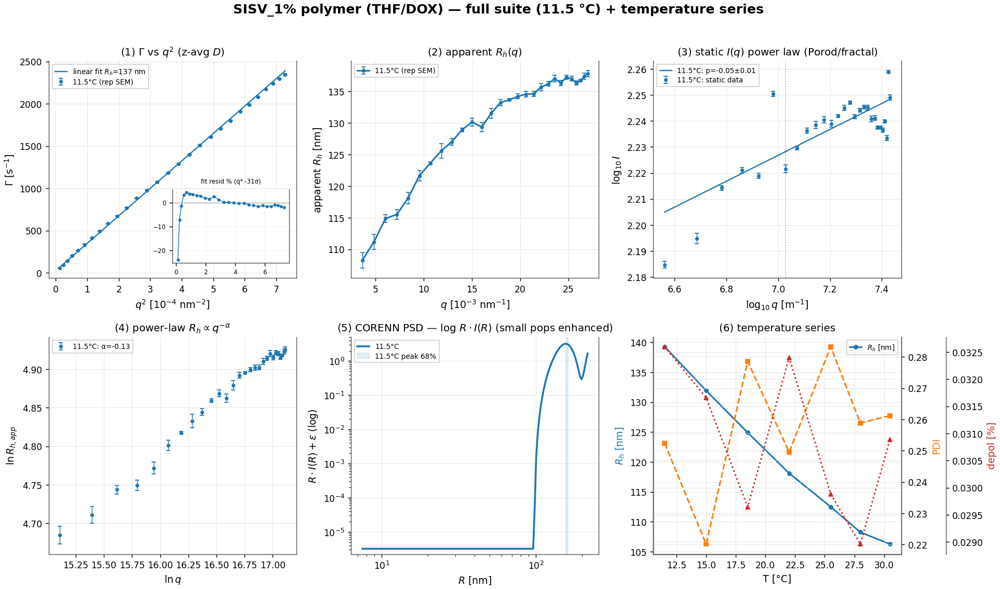

*Consolidating figure: full suite at 11.5 °C (5 panels) plus the temperature series of R_h/PDI/depolarization (raw-derived).*

## Primary Model Results

*Detailed suite shown at the representative temperature (11.5 °C); all temperatures are tabulated below and in the per-temperature panels.*

**Step 1 — per-angle cumulants → Γ(q) (VV).** A 2nd-order cumulant on the initial decay (g1_min=0.6) gives the decay rate at each angle; 28 angles are kept.

**Step 2 — Γ vs q² (apparent diffusion).** A straight-line fit Γ = c + D·q² over all 28 angles (no high-q rolloff detected) gives the **apparent diffusion coefficient D = 3.247e-12 ± 2.4e-15 m²/s → R_h = 137 nm** (r²=1.000) [replicate/repeatability 68% 139–139; angle/model 68% 139–140 nm]. **The fit residuals are structured, not random** (figure inset): they trend systematically with q (Spearman resid–q = -0.70; runs 3 vs ~15 expected) and a q⁴ curvature term is significant at **-31σ** — so even with the rolloff removed, Γ vs q² genuinely **curves downward** — D_app falls with q, a non-diffusive low-q offset (slow large-aggregate mode, weak S(q), or baseline): the line is a chord and no single slope is *the* diffusion coefficient. The q-dependent apparent size (next step) and the CORENN PSD are the proper description.

**Step 3 — apparent R_h(q) (polydispersity).** apparent R_h rises with q, from **115 nm** (low q) to **137 nm** (high q) (curvature C=-2.43e-16, Spearman +0.99); mean PDI 0.25 — a narrow population with weak interparticle structure (S(q)).

**Step 4 — static intensity I(q), regime from the PSD.** The CORENN PSD gives dominant scatterers of R ≈ 157 nm (R_g ≈ 122 nm, sphere-derived from the PSD radius — no Guinier regime is reached, so this is a model estimate, not a measured R_g), so q·R_g spans 0.4–3.3 across the angles → **spans Guinier (low-q) and Porod (high-q)**. The 6 low-q points are in the Guinier window but the intensity does not fall (no positive R_g) — a low-q structure factor S(q) < 1 / interparticle correlations rather than a particle Guinier radius. On the 28 point contiguous lower-q scaling window (q=0.00365–0.027 nm⁻¹): a near-flat / noisy high-q intensity (I ∝ q^+0.0), so no clean Porod slope (r²=0.691) (reported as diagnostic only).

**Step 5 — dynamic q-dependence.** The apparent size follows a power law R_h,app ∝ q^−α with α=-0.13 (r²=0.99) — a compact descriptor of the breadth of the distribution (α→0 monodisperse, α→1 fully scale-free).

**Step 6 — CORENN multi-angle PSD (forward model).** The joint inversion of the resolvable angles, on a radius grid bounded by dynamic observability plus the static q-window (PSD grid 8–217 nm, upper bound set by dynamic) and the main-relaxation lag window (λ=1.1e+02), recovers one q-consistent intensity size distribution: peak(s) at **157 nm (100%)**. An 20-angle bootstrap of the inversion puts the primary peak at 158 nm [68% 156–162; 95% 152–164 nm].

## Static Regime And Shape

The CORENN PSD anticipates which static regime each angle probes (Guinier where q·R_g < 1.3, Porod where q·R ≳ π). When a **valid Porod slope** exists, its exponent informs the form-factor / morphology model (q^−4 a smooth sphere; 3<p<4 a surface fractal, D_s=6−p; p≈3 a rough-surface or branched network; 2≤p<3 a mass-fractal / branched aggregate, D=p; p≈2 a coil; p≈1 a rod). ρ = R_g/R_h is the model-independent shape check (sphere ≈ 0.78, coil ≈ 1.5, rod ≳ 2), determined only when a static Guinier R_g exists.

| condition | q·R_g span | regime | static fit | implied morphology | ρ = R_g/R_h |
|---|---|---|---|---|---|
| 11.5 °C | 0.4–3.3 | spans Guinier (low-q) and Porod (high-q) | flat/rising I∝q^+0.0 (no clean slope) | — | not determined |
| 15.0 °C | 1.2–3.0 | form-factor / Porod (q·R ≳ π throughout) | flat/rising I∝q^+0.0 (no clean slope) | — | not determined |
| 18.5 °C | 0.4–2.6 | spans Guinier (low-q) and Porod (high-q) | flat/rising I∝q^-0.1 (no clean slope) | — | not determined |
| 22.0 °C | 0.5–2.7 | spans Guinier (low-q) and Porod (high-q) | flat/rising I∝q^-0.1 (no clean slope) | — | not determined |
| 25.5 °C | 0.3–2.2 | spans Guinier (low-q) and Porod (high-q) | flat/rising I∝q^+0.0 (no clean slope) | — | not determined |
| 28.0 °C | 0.3–2.2 | spans Guinier (low-q) and Porod (high-q) | flat/rising I∝q^-0.1 (no clean slope) | — | not determined |
| 30.5 °C | 0.3–2.2 | spans Guinier (low-q) and Porod (high-q) | flat/rising I∝q^+0.1 (no clean slope) | — | not determined |

**Particle model.** The PSD assumes a homogeneous-sphere form factor. No valid Porod slope and ρ is **not independently determined** (no Guinier regime, or a low-q structure factor), so the sphere assumption is not confirmed; treat the PSD radii as model-dependent.

## Error Propagation And Sensitivity

Headline R_h and the PSD peak carry bootstrap intervals (ρ where determined). The **replicate** bootstrap is measurement repeatability; the **angle/model** bootstrap is robustness to angle selection — the dominant term for polydisperse samples.

| condition | R_h replicate 68% | R_h angle/model 68% | PSD peak 68% | ρ 68% |
|---|---|---|---|---|
| 11.5 °C | 139–139 nm | 139–140 nm | 156–162 nm | — |
| 15.0 °C | 132–132 nm | 132–132 nm | — | — |
| 18.5 °C | 125–125 nm | 124–125 nm | — | — |
| 22.0 °C | 118–118 nm | 118–118 nm | — | — |
| 25.5 °C | 112–113 nm | 112–113 nm | — | — |
| 28.0 °C | 108–108 nm | 108–109 nm | — | — |
| 30.5 °C | 106–106 nm | 106–107 nm | — | — |

**Systematic sensitivity (not included in the intervals above).** R_h = kT/(6πηD) scales inversely with viscosity, so a viscosity error propagates linearly into R_h; the q calibration (scattering angle + refractive index) shifts every q-dependent quantity; the absolute-intensity (toluene) scale sets the SLS magnitude; and the assumed sphere form factor biases the PSD radii for non-spherical particles. See the Assumption Register.

## Fit Quality And Model Adequacy

Beyond r²: a hold-out cross-validation (predictive R²), a residual-structure test (runs / lag-1 autocorrelation — structured residuals flag model inadequacy even at high r²), and the CORENN inversion's convergence and conditioning.

| condition | Γ-vs-q² R² (in / CV) | Γ resid | CORENN g2 resid | CORENN: conv / GCV / κ / eff-DOF |
|---|---|---|---|---|
| 11.5 °C | 1.000 / 1.000 | **structured** | **structured** | yes / interior / κ=5e+11 / 13/24 |
| 15.0 °C | 1.000 / 1.000 | ok | **structured** | yes / interior / κ=9e+11 / 15/24 |
| 18.5 °C | 1.000 / 1.000 | **structured** | **structured** | yes / interior / κ=1e+10 / 12/24 |
| 22.0 °C | 1.000 / 1.000 | **structured** | **structured** | yes / interior / κ=4e+11 / 15/24 |
| 25.5 °C | 1.000 / 1.000 | **structured** | **structured** | yes / interior / κ=3e+09 / 11/24 |
| 28.0 °C | 1.000 / 1.000 | **structured** | **structured** | yes / boundary / κ=2e+09 / 10/24 |
| 30.5 °C | 1.000 / 1.000 | **structured** | **structured** | yes / boundary / κ=2e+10 / 11/24 |

*Structured Γ-vs-q² residuals reflect the known polydispersity curvature (the single slope is a summary, not the model); structured CORENN g2 residuals flag form-factor / single-distribution imperfection. A predictive CV R² well below the in-sample R² indicates over-fitting / poor extrapolation across angles.*

*Conditioning: κ ≈ 9e+11 means the inversion is **ill-conditioned** (~12 of ~16 double-precision digits lost), so the recovered distribution is fixed by the regularization, not the data alone — reinforcing the modality caveat. The eff-DOF/n_basis above is the **multi-angle** inversion's data-supportable complexity; it is a different inversion from the single-angle stitched one whose eff-DOF (~5–6) appears in the size_max diagnostic.*

## Sample Synthesis

What the independent observables imply about the sample as a colloid — derived only from the scattering data above, with the inversion caveats carried through:

**Physical picture.** The scattering is dominated by ~**156 nm** objects (intensity-weighted); by number the population centres near ~**142 nm**, and the z-average R_h is 139 nm — a single, fairly narrow population — intensity and number weightings nearly agree (see the size-distribution-by-weighting and size_max sections).

**Hydrodynamic shape (Guinier–Porod → Stokes–Einstein).** The static slope identifies the dominant scatterer as **a sphere (assumed)**, so the geometry-matched Stokes–Einstein relation is **D = kT/(6πηR)** — the radius R = R_h is **137 nm**. No resolved Porod slope, so the sphere form is assumed.

**Primary unit.** The number-weighted mode (~142 nm) is the smallest resolved scatterer — plausibly the primary particle or smallest aggregate.

**Caveats that bound these conclusions.** *(1) Dilute limit / S(q):* the analysis assumes single-particle scattering; if the suspension is not dilute, a low-q structure factor (interparticle correlations or incipient gelation) can bias the Porod/fractal slope and the apparent sizes — a dilution series would test it. *(2) Inversion dependence:* the modes and the aggregation number inherit the ill-posedness and size_max / λ / form-factor sensitivity documented in the size-distribution sections. *(3) Stability:* this is a single time-point of a system that can aggregate or sediment; a repeat / time-resolved run (or checking the count rate for drift across the angle scan) is needed to establish the distribution is stationary.

**Consistency across observables.** The narrow dynamic distribution (mean PDI 0.25) is consistent with the single population seen across all weightings. No single observable here is contradicted by another — the picture is one well-defined, fairly narrow population.

## Mode-Specific Diagnostics

### Temperature series (kinetics)

- **z-average R_h** falls smoothly 139→106 nm from 11.5→30.5 °C (but see the viscosity caveat below).

- **PDI** stays narrow and stable (mean 0.26, 0.22–0.28) — a well-defined single population.

- **static intensity** is non-monotonic: a minimum near 15.0 °C (153 kHz/mW) then a rise above ~22 °C — a candidate conformational/aggregation transition.

### Polarization (VV/VH depolarized)

The depolarization ratio I_VH/I_VV is very small (mean 0.031 %), i.e. the polymer is nearly optically isotropic. Splitting translational from rotational diffusion (Γ_VV=q²D_t, Γ_VH=q²D_t+6D_r) gives a small, noisy VH intercept: for this ~120 nm polymer rotational diffusion (D_r∝1/R³) sits near the resolution limit, so the depolarization ratio is the robust observable.

### High-angle correlogram diagnostics (µs–ms ripples)

The high-angle single-exponential residual contains **two distinct features** that separate by their q-scaling: a **long-lag peak** that shifts to shorter lag with increasing angle, and **short-lag wiggles** that barely move. Panels (B)–(D) tell them apart across all angles.

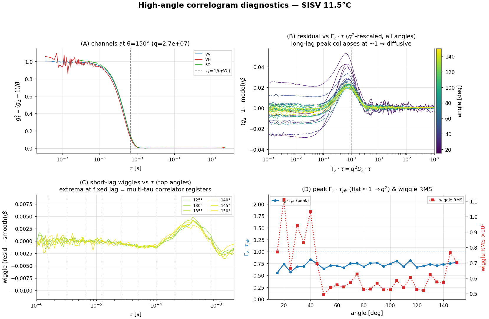

*Reading the panels.* **(A)** VV/VH/3D at the top angle (a faster VH would be the rotational signature Γ_VH=q²D_t+6D_r; a VV-vs-3D split flags modulation / multiple scattering). **(B)** residual vs the q²-rescaled lag Γ_z·τ — a feature that **collapses onto Γ_z·τ≈1** for every angle is a genuine diffusive relaxation. **(C)** the short-lag wiggle component vs *absolute* τ — extrema that line up at **fixed lag** (dotted: the multi-tau correlator register boundaries) are instrumental, not q-dependent dynamics. **(D)** trends: a flat Γ_z·τ_pk ≈ 1 confirms the peak scales as q²; the wiggle RMS grows as the signal weakens at high q.

*This sample — the two features separated across all 28 angles:* **(1) the long-lag peak** sits at Γ_z·τ_pk ≈ 0.74 and stays roughly constant across angles (panel D), i.e. it tracks τ_pk = 1/(q²D_z) ∝ 1/q² and collapses onto a single curve under q² rescaling (panel B) — a **genuine diffusive multi-mode / polydispersity** deviation (the broad relaxation-time distribution of the sample), strongest at high q. **(2) the short-lag wiggles** pin to *fixed* absolute lags (≈ 13, 26, 51, 102 µs), independent of angle and locked to the multi-tau correlator's register boundaries (panel C), with the amplitude growing ≈1× from low to high angle as the signal weakens — a **correlator / instrumental artifact**, not sample dynamics.

Channel check (A): at the top angle Γ_VH/Γ_VV = 1.17, i.e. VH decays faster (a rotational signature *if* not VH shot noise); but the depolarized channel is weak (I_VH/I_VV ≈ 0.0 %) so Γ_VH is noise-limited.

### Slow-mode / large-aggregate tail (single-angle stitched)

The multi-angle intensity PSD is q-resolution-limited: its R^6-weighted q->0 representation, coupled through the sphere form factor, edge-piles for R ≳ π/q_min ≈ **861 nm**. A *single-angle* CORENN inversion of the gap-aware **stitched** correlogram (clean long-lag pooled over the full run, τ_max 50→61 s) instead recovers the slow diffusive modes directly from the decay-rate spectrum — with a data-bounded amplitude, so it resolves the large-aggregate tail where the multi-angle PSD cannot.

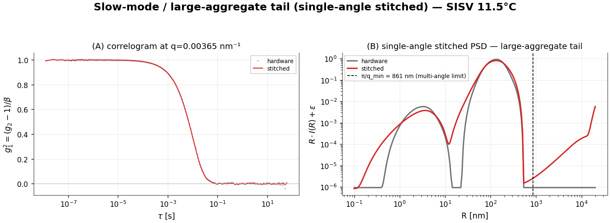

At the lowest angle (q=0.00365 nm⁻¹), the stitched single-angle inversion finds **negligible intensity (<2%) beyond π/q_min** (extent ~273 nm) — there is no resolvable large-aggregate tail; the sample is a single well-defined population, consistent with the multi-angle PSD.

### Size distribution by weighting — continuous summary, then apparent modes

DLS recovers a size distribution by an **ill-posed Laplace inversion**: many different distributions — a smooth continuum or a set of discrete modes — reproduce the measured correlation function equally well within noise, and the regularized inversion (CORENN) returns just one of them, fixed by its smoothness penalty, radius grid, and form-factor assumption. The number and sharpness of peaks are therefore properties of the inversion, not facts the data establish on their own. The report gives **two views**: (1) assumption-light continuous percentiles, and (2) the inversion's apparent modes/shoulders, flagged as inversion-dependent and trustworthy only where they survive the size_max / λ sensitivity tests. CORENN returns the *same* inversion under every weighting (the vendor's Γ / Intensity / Number / Volume tabs); re-weighting only relocates and re-weights the features.

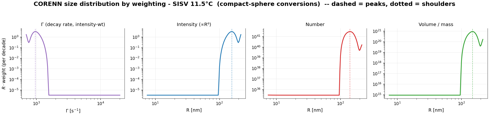

**Γ (decay-rate) view — the rawest signal (figure panel 1).** Before any size model, the dominant intensity component relaxes at Γ ≈ **964 s⁻¹** (relaxation time τ = 1/Γ ≈ **1.04 ms**) at the reference angle; the size columns below are this spectrum mapped through Stokes–Einstein Γ = k_BT q²/(6πηR).

**Continuous-distribution summary (percentiles; no modes assumed).** The assumption-light description — percentiles of the recovered distribution, robust to how it is partitioned into modes. Intensity is narrow (dominated by the largest scatterers); number-weighting (÷R⁶) strongly amplifies the inverted PSD's small-R end, so its percentiles are the least certain.

| Weighting | D10 (nm) | D50 (nm) | D90 (nm) | D_g (nm) | σ_g (GSD) | span | log-skew |
|---|---:|---:|---:|---:|---:|---:|---:|
| Intensity (∝R⁶) | 131 | 155 | 185 | 156 | 1.15 | 0.35 | +0.25 |
| Number (sphere, R⁶) | 119 | 141 | 165 | 141 | 1.13 | 0.33 | +0.19 |
| Volume (sphere, R³) | 125 | 148 | 173 | 148 | 1.14 | 0.33 | +0.21 |

**Modality caveat — read the next table as inversion fine structure.** The Laplace inversion is ill-posed: a smooth continuum and a set of discrete modes can fit the same g₂ within noise, so the number and sharpness of peaks depend on the regularization (λ), the radius grid / size_max, the spline basis, and the sphere form factor — none of which the data uniquely fix. The inversion carries ≈ **13 spline degrees of freedom** — ample latitude to place peaks on a continuum. **Treat the apparent peaks/shoulders below as fine structure of this particular inversion — not established sub-populations — unless they are stable under the size_max / λ sensitivity checks and reproducible across replicates.**

#### Apparent modes & shoulders (CORENN fine structure — inversion-dependent)

| Weighting | Comp. | Peak R (nm) | ⟨R⟩ (nm) | Median (nm) | Fraction | GSD | log-skew |
|---|---|---:|---:|---:|---:|---:|---:|
| Intensity (∝R⁶) | 1 | 156 | 157 | 155 | 100% | 1.15 | +0.25 (≈ log-symmetric) |
| Number (sphere, R⁶) | 1 | 142 | 142 | 141 | 100% | 1.13 | +0.19 (≈ log-symmetric) |
| Volume (sphere, R³) | 1 | 150 | 149 | 148 | 100% | 1.14 | +0.21 (≈ log-symmetric) |

The intensity distribution is led by a peak at **156 nm** (100% of scattered light, ≈ log-symmetric); under number weighting the dominant component is at **142 nm** — the *same* data, modes relocated and re-weighted by the R-power, which is why no single mean describes it.

*Volume/Number assume compact spheres (V∝R³); no mass-fractal correction is applied (the static slope is consistent with a compact / surface-fractal object, D_f≈3).*

### Joint multi-temperature (same sample)

The recorded viscosity is a fixed 0.47 mPa·s at every temperature (THF actually thins on heating). Assuming a T-invariant polymer size, the implied viscosity drops **24 %** over 12→30 °C — consistent with THF — so the apparent R_h decline is mostly the fixed-viscosity artifact, not real shrinkage.

### All analysis panels, at every temperature

The complete static+dynamic suite (Γ-vs-q², apparent R_h(q), regime-aware static I(q), R_h∝q^−α, CORENN PSD, VV/VH depolarized) at each temperature:

**T = 11.5 °C**

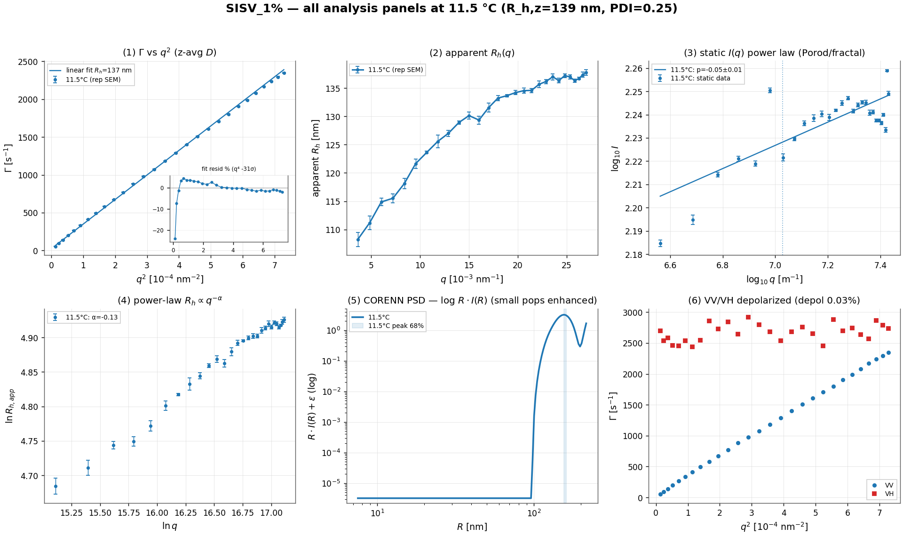

**T = 15.0 °C**

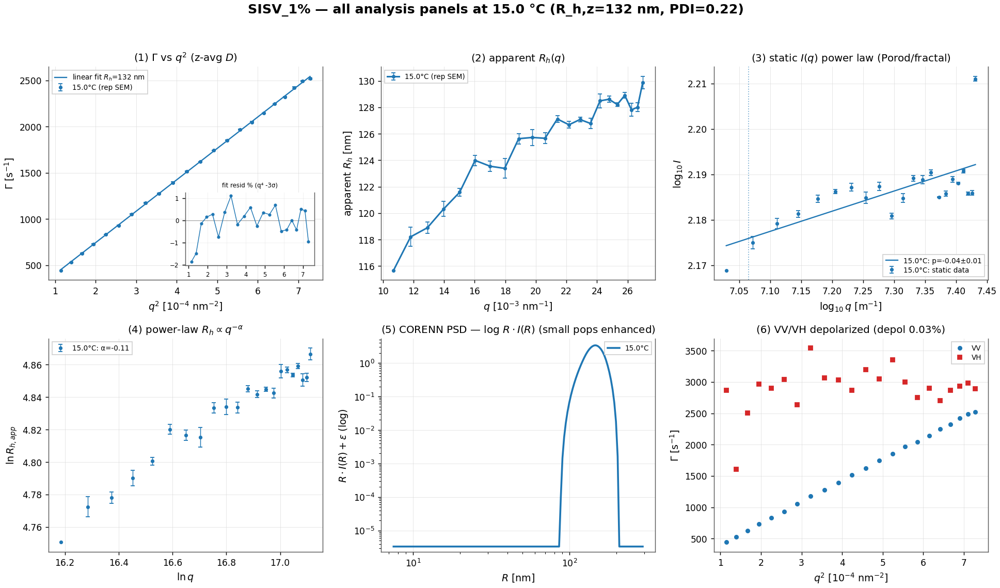

**T = 18.5 °C**

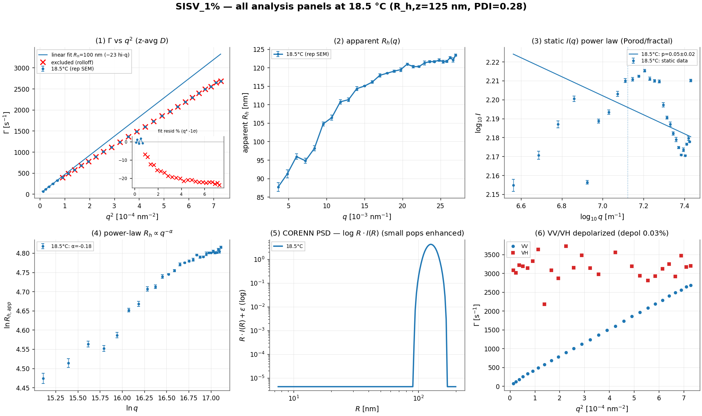

**T = 22.0 °C**

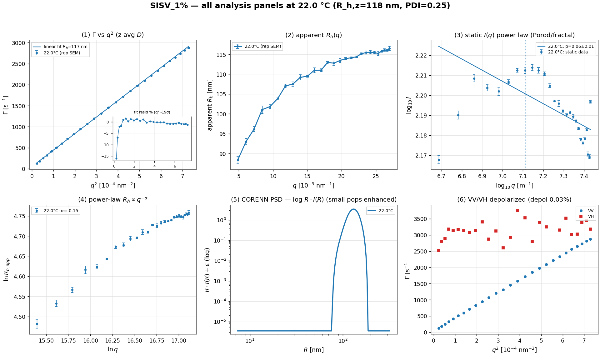

**T = 25.5 °C**

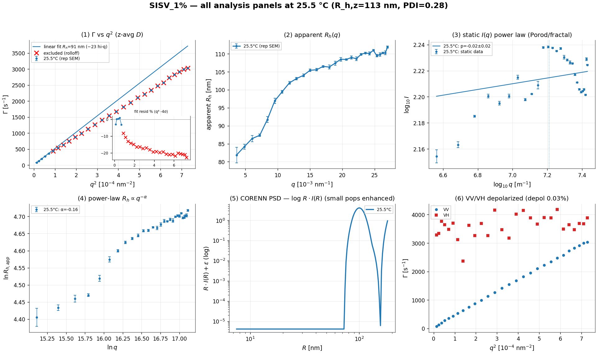

**T = 28.0 °C**

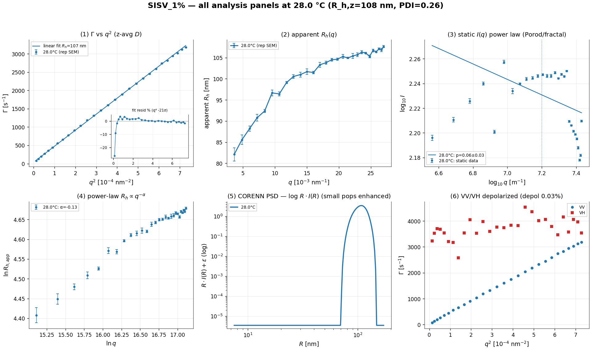

**T = 30.5 °C**

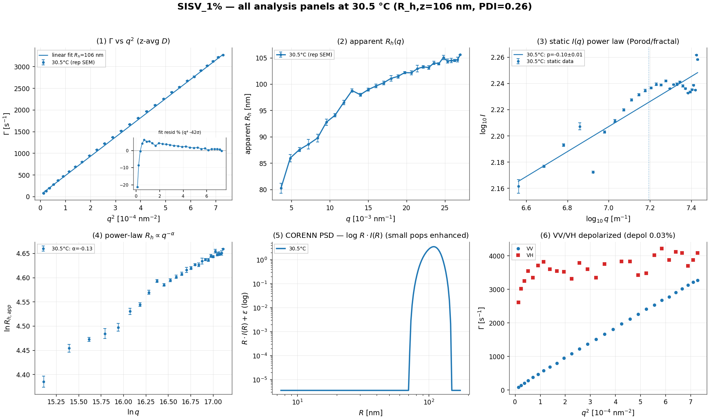

## Data Inventory

One row per analysed condition (per-angle detail is in Per-Curve Fit Results).

| condition | channel | n angles (kept/total) | angle range | q range [nm⁻¹] | T [K] | scaled count rate [kHz/mW] | reps | missing meta |
|---|---|---|---|---|---|---|---|---|
| 11.5 °C | VV | 28/28 | 15–150° | 0.00365–0.027 | 284.6 | 153–181 | 28 | 0 |
| 15.0 °C | VV | 22/22 | 45–150° | 0.0107–0.027 | 288.2 | 148–163 | 21 | 0 |
| 18.5 °C | VV | 28/28 | 15–150° | 0.00365–0.027 | 291.7 | 143–164 | 28 | 0 |
| 22.0 °C | VV | 27/27 | 20–150° | 0.00485–0.027 | 295.1 | 147–164 | 27 | 0 |
| 25.5 °C | VV | 28/28 | 15–150° | 0.00365–0.027 | 298.6 | 143–173 | 28 | 0 |
| 28.0 °C | VV | 28/28 | 15–150° | 0.00365–0.027 | 301.2 | 151–181 | 28 | 0 |
| 30.5 °C | VV | 28/28 | 15–150° | 0.00365–0.027 | 303.6 | 145–183 | 28 | 0 |

## Raw Correlograms

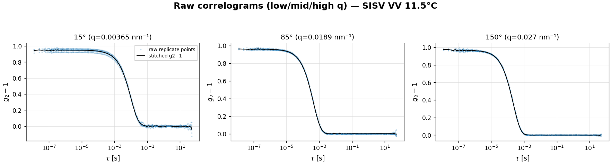

*Raw VV correlograms at low/mid/high q (11.5 °C): the stitched multi-tau correlation (black) over the semi-transparent raw replicate points.*

## Count Rates And Static Intensities (absolute, toluene-referenced)

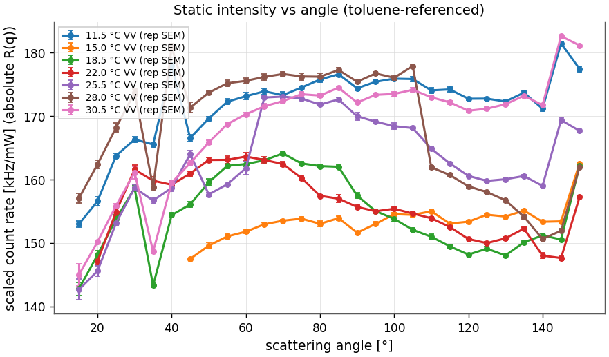

*Scaled count rate (absolute Rayleigh ratio) vs angle, all temperatures (raw data).*

## Per-Curve Fit Results

### Per-curve fits — 11.5 °C (VV)

Per-angle 2nd-order cumulant on the leading decay (g1_min=0.6); R_h,app = kT q²/(6πη Γ).

| angle [°] | q [nm⁻¹] | Γ [1/s] | μ₂ | PDI | β | R_h,app [nm] | reps | accepted |
|---|---|---|---|---|---|---|---|---|
| 15 | 0.00365 | 54.5 | 1.3e+03 | 0.42 | 0.949 | 108 | 5 | yes |
| 20 | 0.00485 | 94.0 | 3.9e+03 | 0.44 | 0.979 | 111 | 5 | yes |
| 25 | 0.00605 | 141.3 | 7.7e+03 | 0.39 | 0.942 | 115 | 5 | yes |
| 30 | 0.00723 | 200.9 | 1.5e+04 | 0.37 | 0.986 | 116 | 5 | yes |
| 35 | 0.0084 | 265.2 | 2.0e+04 | 0.28 | 0.977 | 118 | 5 | yes |
| 40 | 0.00956 | 333.2 | 3.3e+04 | 0.29 | 0.998 | 122 | 5 | yes |
| 45 | 0.0107 | 410.4 | 5.0e+04 | 0.29 | 0.952 | 124 | 5 | yes |
| 50 | 0.0118 | 492.8 | 6.7e+04 | 0.27 | 0.937 | 126 | 5 | yes |
| 55 | 0.0129 | 581.6 | 8.0e+04 | 0.24 | 0.942 | 127 | 5 | yes |
| 60 | 0.014 | 671.9 | 1.0e+05 | 0.22 | 0.944 | 129 | 5 | yes |
| 65 | 0.015 | 768.6 | 1.3e+05 | 0.22 | 0.952 | 130 | 5 | yes |
| 70 | 0.016 | 881.2 | 1.8e+05 | 0.23 | 0.960 | 129 | 5 | yes |
| 75 | 0.017 | 976.1 | 2.2e+05 | 0.23 | 0.970 | 132 | 5 | yes |
| 80 | 0.018 | 1074.5 | 2.6e+05 | 0.23 | 0.959 | 133 | 5 | yes |
| 85 | 0.0189 | 1183.1 | 2.9e+05 | 0.21 | 0.956 | 134 | 5 | yes |
| 90 | 0.0198 | 1290.8 | 3.1e+05 | 0.19 | 0.958 | 134 | 5 | yes |
| 95 | 0.0206 | 1399.7 | 4.0e+05 | 0.20 | 0.956 | 135 | 5 | yes |
| 100 | 0.0214 | 1510.5 | 5.0e+05 | 0.22 | 0.959 | 135 | 5 | yes |
| 105 | 0.0222 | 1607.3 | 5.5e+05 | 0.21 | 0.964 | 136 | 5 | yes |
| 110 | 0.0229 | 1707.2 | 5.9e+05 | 0.20 | 0.960 | 136 | 5 | yes |
| 115 | 0.0236 | 1798.8 | 6.9e+05 | 0.21 | 0.959 | 137 | 5 | yes |
| 120 | 0.0242 | 1905.9 | 7.1e+05 | 0.20 | 0.947 | 136 | 5 | yes |
| 125 | 0.0248 | 1986.9 | 8.5e+05 | 0.21 | 0.954 | 137 | 5 | yes |
| 130 | 0.0253 | 2077.4 | 9.0e+05 | 0.21 | 0.950 | 137 | 5 | yes |
| 135 | 0.0258 | 2169.4 | 1.1e+06 | 0.23 | 0.942 | 136 | 5 | yes |
| 140 | 0.0263 | 2237.9 | 1.1e+06 | 0.22 | 0.944 | 137 | 5 | yes |
| 145 | 0.0267 | 2293.8 | 1.1e+06 | 0.21 | 0.976 | 137 | 5 | yes |
| 150 | 0.027 | 2346.1 | 1.1e+06 | 0.21 | 0.971 | 138 | 5 | yes |

## Rejected Data And Failure Diagnostics

No angles or curves were rejected.

## Assumption Register

| assumption | value | source | affects | sensitivity checked? | comment |
|---|---|---|---|---|---|
| wavelength | 632.8 nm | instrument default | q, D, R_h | no | — |
| refractive index | 1.4 | THF/dioxane 7:3, assumed | q | no | replace with measured |
| viscosity | 0.47, 0.47, 0.47, 0.47, 0.47, 0.47, 0.47 mPa·s | recorded export (fixed 0.47 mPa·s) | R_h | yes | fixed at all temperatures — placeholder; THF thins on heating |
| q source | recalculated from angle | pipeline | all q-dependent fits | no | vendor 'Scattering vector [1/nm]' column is mislabelled (values are 1/m); q recomputed from angle, reported in nm⁻¹ |
| static scale | absolute (toluene-referenced) — assumed, unverified | LSII toluene reference | SLS, R_g | no | toluene reference not confirmable from parsed export |
| form factor | homogeneous sphere (RGD) | pipeline | PSD radii, ρ check | yes | flag if ρ≠0.78 or depolarization present |
| cumulant g1_min | 0.6 | pipeline config | Γ, PDI | yes | leading-decay window |
| PSD radius grid | 8–217 nm | dynamic observability + static q guardrail | PSD peaks | yes | upper=min(dynamic 217 nm, static 861 nm, default 5000 nm); limiting=dynamic; tau_max=0.0082 s, min field decay=0.223 |
| PSD basis | 24 B-spline control points | pipeline config | PSD smoothness | yes | — |
| regularization | GCV-selected λ=1.1e+02 | pipeline | PSD width | yes | interior minimum required |
| baseline | free per fit (CORENN); leading-decay cumulant | pipeline config | Γ, PSD | yes | — |

## Quality Gates

Provisional report: **11 PASS, 2 WAIVE, 0 FAIL** of 13.

| gate | status | note |
|---|---|---|
| q physically plausible / reproducible from angle | **PASS** | q recomputed from angle (vendor q column mislabeled 1/nm) |
| viscosity not a placeholder | **WAIVE** | same η recorded across temperatures — flagged placeholder |
| fit bounds stated for every fit | **PASS** | cumulant g1_min=0.6; CORENN tau_max=0.0082s, Rmax=217 nm (dynamic) |
| rejected curves/angles listed | **PASS** | 0 rejected, tabulated |
| residual-structure test reported (not r² alone) | **PASS** | runs test + lag-1 autocorrelation |
| headline R_h carries a bootstrap CI | **PASS** | replicate + angle/model bootstrap |
| hold-out cross-validation reported | **PASS** | leave-one-angle-out |
| CORENN converged + well-posed regularization | **PASS** | converged=True, GCV interior=True, κ=5e+11 |
| static scale confirmed absolute | **WAIVE** | toluene reference assumed (LSII default), not confirmable from parsed export |
| PSD basis (intensity/volume/number) stated | **PASS** | intensity-weighted primary, conversions noted |
| ρ = R_g/R_h and particle model stated | **PASS** | not determined; sphere form factor assumed |
| multi-temperature size/viscosity ambiguity addressed | **PASS** | same-sample joint-temperature solve reported |
| figure captions state raw vs derived | **PASS** | captions included |

## Metadata

| field | value |
|---|---|
| Report title | SISV_1% polymer (THF/DOX 7:3) — provisional DLS analysis report |
| Data source | data/SISV_1% |
| Report generator | reports/sisv_report.py (provisional) |
| Analyst / owner | automated pipeline |
| Dataset class | multi-angle, multi-temperature, polarized (VH/VV/3D) |
| Channels present | VV |
| Temperatures | 284.6 K, 288.2 K, 291.7 K, 295.1 K, 298.6 K, 301.2 K, 303.6 K |
| Angles | 15–150° (189 per condition) |
| q range | 0.00365–0.027 nm⁻¹ |
| Replicates | 188 angle-sets with ≥2 replicates |
| Solvent constants | η per condition (see table); n=1.4, λ=632.8 nm (THF/dioxane 7:3, assumed) |
| Static scale | absolute (toluene-referenced) — assumed, unverified |
| Particle model | homogeneous sphere (assumed; ρ not determined — low-q S(q)) |
| Primary model | CORENN multi-angle PSD (VV) + same-sample joint-temperature solve |
| Report limitations | viscosity placeholder; MAPCS replicates not exposed (angle bootstrap); sphere model assumed |

## Reproducibility Appendix

| item | value |
|---|---|
| Command | `python reports/sisv_report.py` |
| Environment | python 3.13.5, numpy 2.2.5 |
| Git commit (working tree) | 91a3b68 (dirty) |
| Random seeds | bootstraps seed=0 (fixed) |
| Generated files | SISV.md, SISV.pdf, figures/sisv.png, figures/sisv_raw_rep.png, figures/sisv_slowmode.png, figures/sisv_weightings.png, figures/sisv_countrate.png, figures/sisv_highangle.png, SISV.sidecar.json, figures/sisv_T11p5.png, figures/sisv_T15p0.png, figures/sisv_T18p5.png, figures/sisv_T22p0.png, figures/sisv_T25p5.png, figures/sisv_T28p0.png, figures/sisv_T30p5.png |
