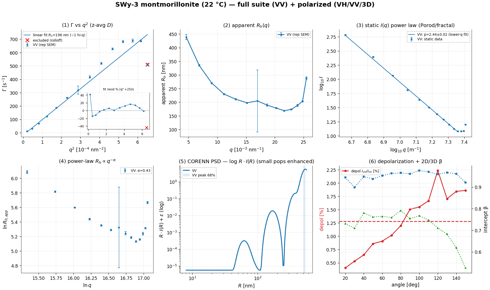
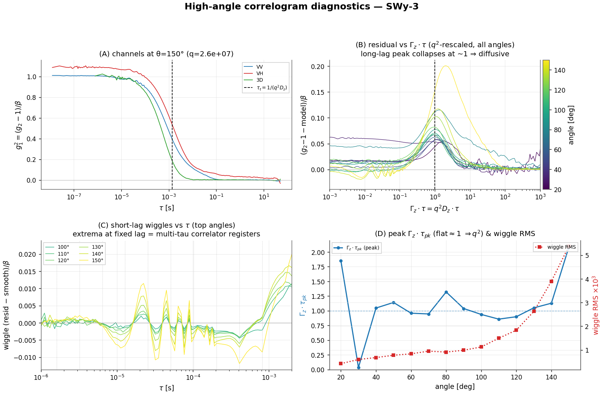
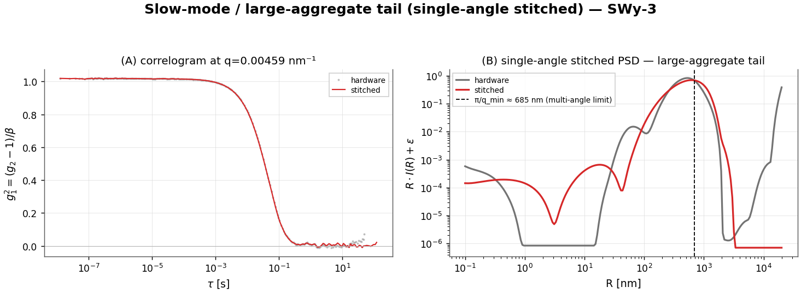
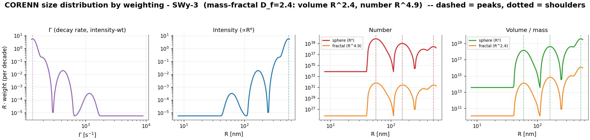
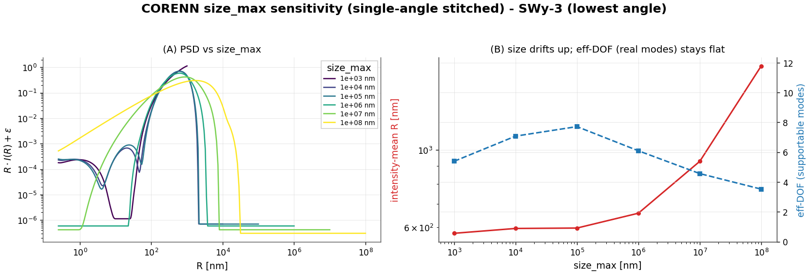
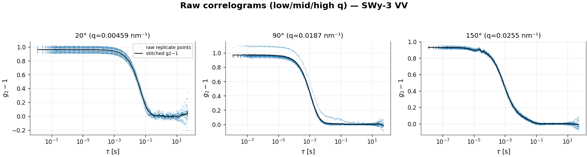
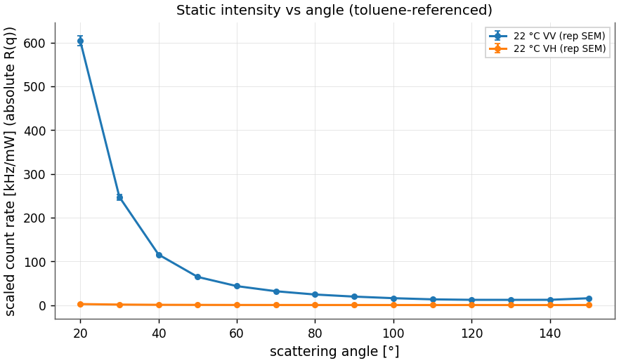

# SWy-3 montmorillonite (1 %, 22 °C) — provisional polarized DLS analysis report

## Executive Summary

**Dataset.** SWy-3 Wyoming montmorillonite clay in water at 22 °C by multi-angle PCS: 14 angles (20–150°), three measurements per angle — depolarized VH, polarized VV (both 2D pseudo-cross), and 3D modulated cross, 10 repetitions each. The full suite runs on VV.

**Main result.** A flocculated Wyoming-montmorillonite clay suspension — anisotropic platelets aggregated into broad, mass-fractal flocs in water.

- **Size:** the scattering is dominated by ~**507 nm** flocs (intensity-weighted); by number the population centres near ~**56 nm**; z-average R_h **203 nm**; broad / polydisperse (mean PDI 0.52).
- **Structure:** the static Porod slope I ∝ q^−2.44±0.02 ⇒ **mass fractal / branched (D≈2.4)** — a restructured / branched floc, not compact spheres, so the sphere PSD form factor is only an effective approximation and **ρ = R_g/R_h is not determined**.
- **Anisotropy:** a depolarized signal I_VH/I_VV ≈ 1.3% confirms plate-like, optically anisotropic scatterers; rotational diffusion is **not credibly resolved** (carried only by the weak VH channel).
- **Measurement limits:** the lowest q still has q·R_g ≈ 1.8 (> 1.3), so no Guinier regime is reached — R_g, aggregation number and ρ are not directly measurable; the toluene absolute-intensity scale is unverified.

**Confidence.** The z-average r_h carries replicate/angle bootstrap intervals; leave-one-angle-out cv gives predictive r²=0.860; the corenn inversion converged.

**Assumption-sensitive.** Viscosity, refractive index, q-from-angle calibration, the toluene/absolute-intensity reference, the assumed sphere form factor, and the CORENN regularization all enter the reported sizes; see the Assumption Register.

**Recommended next action.** fit a mass-fractal (and/or oblate-disk) form factor — the Porod slope rules out compact spheres; confirm the toluene reference to lock the absolute SLS scale.

> **Provisional flags:** toluene/absolute-intensity reference not confirmable from the export; lower-q Porod/fractal slope q^−2.44±0.02 implies a mass-fractal / branched floc, not the sphere assumed by the PSD; high-q SWy3 points flatten/upturn and are excluded from the slope as an end-of-scaling/background diagnostic; the clay is optically anisotropic (plate-shaped) — the sphere/translational model is an approximation.

## Summary Table

| quantity | value |
|---|---|
| angles × channels | 14 × (VH, VV, 3D) |
| z-average R_h (all-q slope) [68%/95% CI] | 203 [68% 180–227; 95% 167–255] nm |
| apparent D (linear Γ vs q², rolloff excl.) | D=1.16e-12±4.3e-15 m²/s → R_h=196 nm (linear fit, 13/14 angles, −1 hi-q rolloff at q≤0.0248 nm⁻¹) |
| shape ρ = R_g/R_h | not determined (Porod regime) |
| apparent R_h low→high q | 387→246 nm |
| static power-law I∝q^−p | p=2.44±0.02 (r²=0.999, q=0.00459–0.0229 nm⁻¹) |
| implied morphology (Porod) | mass fractal / branched (D≈2.4) |
| platelet radius a = (π/2)·R_h (oblate-disk SE) | primary ≈ 88 nm; floc-eff ≈ 308 nm |
| Γ(q²) predictive R² (LOO-CV) | 0.860 (in-sample 0.911) |
| CORENN eff.DOF / cond | 18/24, κ=6e+13 |
| CORENN multi-angle PSD | 507 nm (96%), 350 nm (4%) |
| CORENN peak [68%/95% CI, bootstrap] | 511 [68% 505–535; 95% 498–538] nm |
| 6 D_r (VH−VV intercept) | 154.8 /s (not credibly resolved) |
| depolarization ratio | 1.28 % |
| mean intercept β (2D / 3D) | 0.95 / 0.72 |

## Consolidating Figures

*Consolidating figure: 5 suite panels (VV) plus the depolarization ratio and 2D/3D coherence β vs angle (raw-derived). Error bars are 1 SEM across repetitions where repetitions exist; the static exponent is fit only on the accepted lower-q scaling window.*

## Primary Model Results

**Channel identification.** Per angle, the two pseudo-cross measurements are VH (low count rate) and VV (high count rate); the third is a 3D modulated cross. q is recomputed from the angle. The full static+dynamic suite runs on the polarized VV channel.

**Step 1 — per-angle cumulants → Γ(q) (VV).** A 2nd-order cumulant on the initial decay (g1_min=0.6) gives the decay rate at each angle; 14 angles are kept.

**Step 2 — Γ vs q² (apparent diffusion).** Γ vs q² is linear over the bulk but the **1 highest-q angle(s) roll off** (Γ plateaus/drops at q = 0.0255 nm⁻¹ — weak signal, number fluctuations, and residual multiple scattering at high angle), so they are excluded. A straight-line fit Γ = c + D·q² to the remaining **13 of 14 angles** (q ≤ 0.0248 nm⁻¹, σ from replicate SEM) gives the **apparent diffusion coefficient D = 1.156e-12 ± 4.3e-15 m²/s → R_h = 196 nm** (vs 203 nm for the all-angle fit that includes the rolloff). The fitted intercept c ≈ -18/s is non-zero — a low-q curvature / non-diffusive offset (large-aggregate slow mode, baseline, or weak S(q)) — so read D as the slope of the linear region, not Γ/q². **The fit residuals are structured, not random** (figure inset): they trend systematically with q (Spearman resid–q = +0.49; runs 4 vs ~7 expected) and a q⁴ curvature term is significant at **+25σ** — so even with the rolloff removed, Γ vs q² genuinely **curves upward** — D_app rises with q, the signature of **polydispersity**: the line is a chord and no single slope is *the* diffusion coefficient. The q-dependent apparent size (next step) and the CORENN PSD are the proper description.

**Step 3 — apparent R_h(q) (polydispersity).** apparent R_h falls with q, from **387 nm** (low q) to **246 nm** (high q) (curvature C=7.75e-16, Spearman -0.58); mean PDI 0.52 — a broad / multi-modal population (large-particle tail at low q).

**Step 4 — static intensity I(q), regime from the PSD.** The CORENN PSD gives dominant scatterers of R ≈ 500 nm (R_g ≈ 387 nm, sphere-derived from the PSD radius — no Guinier regime is reached, so this is a model estimate, not a measured R_g), so q·R_g spans 1.8–9.9 across the angles → **form-factor / Porod (q·R ≳ π throughout)**. On the 11 point contiguous lower-q scaling window (q=0.00459–0.0229 nm⁻¹): I ∝ q^−2.44±0.02 → **a mass fractal — a branched / randomly-branched / aggregated network, mass-fractal dimension D≈2.4** (r²=0.999). The 3 higher-q point(s) are excluded from the exponent because they show flattening followed by an upturn relative to the lower-q scaling law; physically this is the end of the mass-fractal / form-factor scaling range plus the form-factor rise of a smaller, weakly-scattering population — an *upturn* rather than a plateau is the signature of small particles, consistent with the small-R modes that appear under number-weighting in the size-distribution section below, not a second Porod law.

**Step 5 — dynamic q-dependence.** The apparent size follows a power law R_h,app ∝ q^−α with α=0.43 (r²=0.65) — a compact descriptor of the breadth of the distribution (α→0 monodisperse, α→1 fully scale-free).

**Step 6 — CORENN multi-angle PSD (forward model).** The joint inversion of the resolvable angles, on a radius grid bounded by dynamic observability plus the static q-window (PSD grid 8–560 nm, upper bound set by dynamic) and the main-relaxation lag window (λ=1.4e+00), recovers one q-consistent intensity size distribution: peak(s) at **507 nm (96%), 350 nm (4%)** — this peak sits at the PSD upper observability bound (~560 nm); the true material may extend beyond the measured lag/q window, so treat it as an unresolved slow-tail / lower-bound signature rather than a resolved peak.. An 20-angle bootstrap of the inversion puts the primary peak at 511 nm [68% 505–535; 95% 498–538 nm].

## Static Regime And Shape

The CORENN PSD anticipates which static regime each angle probes (Guinier where q·R_g < 1.3, Porod where q·R ≳ π). When a **valid Porod slope** exists, its exponent informs the form-factor / morphology model (q^−4 a smooth sphere; 3<p<4 a surface fractal, D_s=6−p; p≈3 a rough-surface or branched network; 2≤p<3 a mass-fractal / branched aggregate, D=p; p≈2 a coil; p≈1 a rod). ρ = R_g/R_h is the model-independent shape check (sphere ≈ 0.78, coil ≈ 1.5, rod ≳ 2), determined only when a static Guinier R_g exists.

| condition | q·R_g span | regime | static fit | implied morphology | ρ = R_g/R_h |
|---|---|---|---|---|---|
| 22 °C | 1.8–9.9 | form-factor / Porod (q·R ≳ π throughout) | Porod/fractal I∝q^−2.44±0.02, q=0.00459–0.0229 nm⁻¹ | mass fractal / branched (D≈2.4) | not determined |

**Particle model.** The PSD inversion assumes a homogeneous-sphere form factor (which predicts a Porod slope q^−4). The measured static power law instead implies — 22 °C: a mass fractal — a branched / randomly-branched / aggregated network, mass-fractal dimension D≈2.4. The sphere form factor is therefore **inconsistent with the static data**: read the PSD peak as the *effective size* of a rough / branched aggregate rather than a compact-sphere radius, and prefer a fractal (surface- or mass-fractal) form factor for a quantitative size. ρ = R_g/R_h is not independently determined here, so it cannot further constrain the shape.

## Error Propagation And Sensitivity

Headline R_h and the PSD peak carry bootstrap intervals (ρ where determined). The **replicate** bootstrap is measurement repeatability; the **angle/model** bootstrap is robustness to angle selection — the dominant term for polydisperse samples.

| condition | R_h replicate 68% | R_h angle/model 68% | PSD peak 68% | ρ 68% |
|---|---|---|---|---|
| 22 °C | 201–204 nm | 180–227 nm | 505–535 nm | — |

**Systematic sensitivity (not included in the intervals above).** R_h = kT/(6πηD) scales inversely with viscosity, so a viscosity error propagates linearly into R_h; the q calibration (scattering angle + refractive index) shifts every q-dependent quantity; the absolute-intensity (toluene) scale sets the SLS magnitude; and the assumed sphere form factor biases the PSD radii for non-spherical particles. See the Assumption Register.

## Fit Quality And Model Adequacy

Beyond r²: a hold-out cross-validation (predictive R²), a residual-structure test (runs / lag-1 autocorrelation — structured residuals flag model inadequacy even at high r²), and the CORENN inversion's convergence and conditioning.

| condition | Γ-vs-q² R² (in / CV) | Γ resid | CORENN g2 resid | CORENN: conv / GCV / κ / eff-DOF |
|---|---|---|---|---|
| 22 °C | 0.911 / 0.860 | **structured** | **structured** | yes / interior / κ=6e+13 / 18/24 |

*Structured Γ-vs-q² residuals reflect the known polydispersity curvature (the single slope is a summary, not the model); structured CORENN g2 residuals flag form-factor / single-distribution imperfection. A predictive CV R² well below the in-sample R² indicates over-fitting / poor extrapolation across angles.*

*Conditioning: κ ≈ 6e+13 means the inversion is **severely ill-conditioned** (~14 of ~16 double-precision digits lost), so the recovered distribution is fixed by the regularization, not the data alone — reinforcing the modality caveat. The eff-DOF/n_basis above is the **multi-angle** inversion's data-supportable complexity; it is a different inversion from the single-angle stitched one whose eff-DOF (~5–6) appears in the size_max diagnostic.*

## Sample Synthesis

What the independent observables imply about the sample as a colloid — derived only from the scattering data above, with the inversion caveats carried through:

**Physical picture.** The scattering is dominated by ~**539 nm** objects (intensity-weighted); by number the population centres near ~**56 nm**, and the z-average R_h is 203 nm — best read as one broad, polydisperse distribution spanning these scales rather than well-separated species (see the size-distribution-by-weighting and size_max sections).

**Hydrodynamic shape (Guinier–Porod → Stokes–Einstein).** The static slope identifies the dominant scatterer as **a mass-fractal aggregate (D≈2.4)**, so the geometry-matched Stokes–Einstein relation is **D = kT/(6πηR_h) (Stokes radius)** — the effective Stokes radius R_h is **196 nm**. That ~2D slope is geometrically degenerate, so **a thin oblate disk / platelet** is equally consistent — then D = kT/(12ηa) ⇒ a = (π/2)R_h → the disk radius a is **308 nm**. A branched aggregate has no closed-form Stokes–Einstein, so R_h is an effective Stokes radius; the same ~2D slope is also consistent with a flat platelet building block (disk SE).

**Floc structure & aggregation mechanism.** The static Porod slope gives a mass-fractal dimension **D_f ≈ 2.4**, which points to **a restructured / compacted aggregate — denser than simple RLCA (internal reorganization, or for plates an edge–face 'house-of-cards' association)**. Taking the ~56 nm number-mode as the primary unit, the fractal scaling N ≈ (R_floc/R_primary)^D_f gives an order-of-magnitude **aggregation number N ~ 250** primary units per ~539 nm floc (geometric, and sensitive to the primary-size choice and the inversion).

**Primary unit.** The number-weighted mode (~56 nm) is the smallest resolved scatterer — plausibly the primary particle or smallest aggregate. A depolarized signal (I_VH/I_VV ≈ 1.3%) shows the scatterers are optically anisotropic (plate- or rod-like primaries), but rotational diffusion is not credibly resolved (the depolarized fit gives D_t(VH)=6.2e-13 m²/s, 0.6× the polarized D_t(VV)=1.1e-12 — inconsistent for one translational mode; the depolarized channel is weak (I_VH/I_VV ≈ 1.3%)), so an independent shape/size from rotation is not available here.

**Not determinable from this angular range.** The lowest q still has q·R_g ≈ 1.8 (> 1.3), so the **Guinier regime is never reached**: an independent radius of gyration, an absolute molar mass / aggregation number, and ρ = R_g/R_h cannot be measured here — only inferred. Reaching them needs q ≲ 0.00336 nm⁻¹ (smaller scattering angles, low-q SLS, or SAXS).

**Caveats that bound these conclusions.** *(1) Dilute limit / S(q):* the analysis assumes single-particle scattering; if the suspension is not dilute, a low-q structure factor (interparticle correlations or incipient gelation) can bias the Porod/fractal slope and the apparent sizes — a dilution series would test it. *(2) Inversion dependence:* the modes and the aggregation number inherit the ill-posedness and size_max / λ / form-factor sensitivity documented in the size-distribution sections. *(3) Stability:* this is a single time-point of a system that can aggregate or sediment; a repeat / time-resolved run (or checking the count rate for drift across the angle scan) is needed to establish the distribution is stationary.

**Consistency across observables.** The broad dynamic distribution (mean PDI 0.52, apparent R_h falling with q) matches the polydisperse fractal floc inferred from the static slope; the non-sphere Porod slope and the undetermined ρ agree (both say 'not a compact sphere'). No single observable here is contradicted by another — the picture is one broad, anisotropic, polydisperse population rather than a set of distinct species.

## Mode-Specific Diagnostics

### Rotational diffusion (depolarized VV/VH)

Polarized and depolarized translational diffusion: D_t(VV)=1.12e-12, D_t(VH)=6.15e-13 m²/s. The VH−VV intercept difference 6D_r = 154.8 /s makes rotation **not credibly resolved**: the depolarized fit gives D_t(VH)=6.2e-13 m²/s, 0.6× the polarized D_t(VV)=1.1e-12 — inconsistent for one translational mode; the depolarized channel is weak (I_VH/I_VV ≈ 1.3%). These are sub-µm clay flocs, for which whole-floc rotation (D_r ∝ 1/R³) is intrinsically too slow to resolve; the individual platelets are strongly anisotropic but their rotation is carried only by the weak depolarized channel.

### Optical anisotropy (depolarization ratio)

The depolarized ratio I_VH/I_VV averages **1.28 %** (0.40–2.24 % across angles). Montmorillonite platelets are optically anisotropic (form birefringence of a thin disk), so a non-zero VH signal is expected; the ratio quantifies the anisotropy of the scattering objects (single platelets vs. more isotropic flocs) and is the robust polarization observable here.

### Platelet hydrodynamics (oblate-disk Stokes–Einstein)

The Guinier–Porod slope is dimensionally ~2D and the depolarized channel shows optical anisotropy — both pointing to **thin plates** (consistent with montmorillonite's platelet habit), so the sphere relation R_h = k_BT/(6πηD) is not the natural size. For a thin **oblate disk** of radius a the orientation-averaged translational diffusion is **D_t = k_BT/(12ηa)** — a disk diffuses like a sphere of radius R_h = (2/π)a, so the **platelet radius a = (π/2)·R_h ≈ 1.57 R_h** (tumbling rotation D_r = 3k_BT/(32ηa³)).

- **Individual platelets** (number-weighted primary, R_h ≈ 56 nm) → disk radius **a ≈ 88 nm** (~177 nm lateral) — in the montmorillonite platelet-size range, and the morphology for which the thin-disk law is rigorous.

- **Dominant scatterers** (z-average R_h ≈ 196 nm) → effective disk radius **≈ 308 nm**, but these are **fractal flocs (D_f ≈ 2.4), not single platelets**, so neither sphere nor thin-disk is exact; the sphere R_h stays the conventional Stokes radius and the disk value is only an effective size.

- **Rotation (depolarized).** Taken at face value the measured 6D_r = 154.8/s (D_r ≈ 25.8/s) gives a disk radius **≈ 249 nm** via D_r = 3k_BT/(32ηa³); but rotation is **not credibly resolved** (weak VH channel), so this is illustrative, not a measurement.

The thin-disk Stokes–Einstein is the right morphology for the **primary platelets** (~88 nm radius); the micron-scale flocs that dominate the scattering are fractal aggregates best described by the sphere R_h.

### 2D vs 3D cross-correlation (multiple scattering)

The 3D modulated cross-correlation suppresses multiple scattering, important for a turbid clay suspension. The coherence factor (intercept β) averages 0.95 for 2D VV vs 0.72 for 3D; their angular dependence (consolidating panel 6) flags where multiple-scattering / geometry corrections matter.

### High-angle correlogram diagnostics (µs–ms ripples)

The high-angle single-exponential residual contains **two distinct features** that separate by their q-scaling: a **long-lag peak** that shifts to shorter lag with increasing angle, and **short-lag wiggles** that barely move. Panels (B)–(D) tell them apart across all angles.

*Reading the panels.* **(A)** VV/VH/3D at the top angle (a faster VH would be the rotational signature Γ_VH=q²D_t+6D_r; a VV-vs-3D split flags modulation / multiple scattering). **(B)** residual vs the q²-rescaled lag Γ_z·τ — a feature that **collapses onto Γ_z·τ≈1** for every angle is a genuine diffusive relaxation. **(C)** the short-lag wiggle component vs *absolute* τ — extrema that line up at **fixed lag** (dotted: the multi-tau correlator register boundaries) are instrumental, not q-dependent dynamics. **(D)** trends: a flat Γ_z·τ_pk ≈ 1 confirms the peak scales as q²; the wiggle RMS grows as the signal weakens at high q.

*This sample — the two features separated across all 14 angles:* **(1) the long-lag peak** sits at Γ_z·τ_pk ≈ 1.04 and stays roughly constant across angles (panel D), i.e. it tracks τ_pk = 1/(q²D_z) ∝ 1/q² and collapses onto a single curve under q² rescaling (panel B) — a **genuine diffusive multi-mode / polydispersity** deviation (the broad relaxation-time distribution of the sample), strongest at high q. **(2) the short-lag wiggles** pin to *fixed* absolute lags (≈ 13, 26, 51, 102 µs), independent of angle and locked to the multi-tau correlator's register boundaries (panel C), with the amplitude growing ≈13× from low to high angle as the signal weakens — a **correlator / instrumental artifact**, not sample dynamics.

Channel check (A): at the top angle Γ_VH/Γ_VV = 0.68, i.e. VH decays slower — not a rotational signature; but the depolarized channel is weak (I_VH/I_VV ≈ 1.3 %) so Γ_VH is noise-limited.

### Slow-mode / large-aggregate tail (single-angle stitched)

The multi-angle intensity PSD is q-resolution-limited: its R^6-weighted q->0 representation, coupled through the sphere form factor, edge-piles for R ≳ π/q_min ≈ **685 nm**. A *single-angle* CORENN inversion of the gap-aware **stitched** correlogram (clean long-lag pooled over the full run, τ_max 50→123 s) instead recovers the slow diffusive modes directly from the decay-rate spectrum — with a data-bounded amplitude, so it resolves the large-aggregate tail where the multi-angle PSD cannot.

At the lowest angle (q=0.00459 nm⁻¹), where large aggregates scatter most strongly (forward, ∝R^6), the stitched single-angle inversion finds **34% of the intensity beyond π/q_min** (vs 27% from the noise-dominated hardware long-lag), extending to ~1190 nm — confirming and sizing the large-aggregate tail the multi-angle PSD must omit. Read it as a *hydrodynamic* (slow-diffusion), intensity-weighted view: these aggregates dominate the low-angle intensity even though they are a small *number* fraction, so this is the resolvable home of the aggregate mass — not a contradiction of the few-hundred-nm q-consistent main population in the multi-angle PSD.

### Size distribution by weighting — continuous summary, then apparent modes

DLS recovers a size distribution by an **ill-posed Laplace inversion**: many different distributions — a smooth continuum or a set of discrete modes — reproduce the measured correlation function equally well within noise, and the regularized inversion (CORENN) returns just one of them, fixed by its smoothness penalty, radius grid, and form-factor assumption. The number and sharpness of peaks are therefore properties of the inversion, not facts the data establish on their own. The report gives **two views**: (1) assumption-light continuous percentiles, and (2) the inversion's apparent modes/shoulders, flagged as inversion-dependent and trustworthy only where they survive the size_max / λ sensitivity tests. CORENN returns the *same* inversion under every weighting (the vendor's Γ / Intensity / Number / Volume tabs); re-weighting only relocates and re-weights the features.

**Γ (decay-rate) view — the rawest signal (figure panel 1).** Before any size model, the dominant intensity component relaxes at Γ ≈ **134 s⁻¹** (relaxation time τ = 1/Γ ≈ **7.49 ms**) at the reference angle; the size columns below are this spectrum mapped through Stokes–Einstein Γ = k_BT q²/(6πηR).

**Continuous-distribution summary (percentiles; no modes assumed).** The assumption-light description — percentiles of the recovered distribution, robust to how it is partitioned into modes. Intensity is narrow (dominated by the largest scatterers); number-weighting (÷R⁶) strongly amplifies the inverted PSD's small-R end, so its percentiles are the least certain.

| Weighting | D10 (nm) | D50 (nm) | D90 (nm) | D_g (nm) | σ_g (GSD) | span | log-skew |
|---|---:|---:|---:|---:|---:|---:|---:|
| Intensity (∝R⁶) | 442 | 510 | 550 | 496 | 1.14 | 0.21 | -4.39 |
| Number (fractal, R^4.9) | 52 | 68 | 486 | 113 | 2.31 | 6.36 | +0.72 |
| Number (sphere, R⁶) | 50 | 58 | 152 | 69 | 1.63 | 1.76 | +2.37 |
| Volume (fractal, R^2.4) | 312 | 494 | 545 | 431 | 1.49 | 0.47 | -2.95 |
| Volume (sphere, R³) | 159 | 483 | 543 | 381 | 1.74 | 0.79 | -2.09 |

**Modality caveat — read the next table as inversion fine structure.** The Laplace inversion is ill-posed: a smooth continuum and a set of discrete modes can fit the same g₂ within noise, so the number and sharpness of peaks depend on the regularization (λ), the radius grid / size_max, the spline basis, and the sphere form factor — none of which the data uniquely fix. The inversion carries ≈ **18 spline degrees of freedom** — ample latitude to place peaks on a continuum. **Treat the apparent peaks/shoulders below as fine structure of this particular inversion — not established sub-populations — unless they are stable under the size_max / λ sensitivity checks and reproducible across replicates.**

#### Apparent modes & shoulders (CORENN fine structure — inversion-dependent)

| Weighting | Comp. | Peak R (nm) | ⟨R⟩ (nm) | Median (nm) | Fraction | GSD | log-skew |
|---|---|---:|---:|---:|---:|---:|---:|
| Intensity (∝R⁶) | 1 | 539 | 502 | 511 | 99% | 1.11 | -1.93 (tail → small R) |
| Number (fractal, R^4.9) | 1 | 57 | 58 | 58 | 55% | 1.13 | +0.26 (≈ log-symmetric) |
|  | 2 | 157 | 159 | 158 | 24% | 1.12 | +0.14 (≈ log-symmetric) |
|  | 3 | 513 | 463 | 482 | 21% | 1.18 | -1.07 (tail → small R) |
| Number (sphere, R⁶) | 1 | 56 | 57 | 57 | 85% | 1.13 | +0.28 (≈ log-symmetric) |
|  | 2 | 154 | 157 | 155 | 12% | 1.12 | +0.17 (≈ log-symmetric) |
|  | 3 | 506 | 449 | 470 | 3% | 1.20 | -0.78 (tail → small R) |
| Volume (fractal, R^2.4) | 1 | 527 | 487 | 500 | 91% | 1.14 | -1.63 (tail → small R) |
|  | 2 | 163 | 165 | 163 | 8% | 1.12 | +0.05 (≈ log-symmetric) |
| Volume (sphere, R³) | 1 | 524 | 482 | 497 | 83% | 1.15 | -1.52 (tail → small R) |
|  | 2 | 162 | 163 | 162 | 13% | 1.12 | +0.07 (≈ log-symmetric) |
|  | 3 | 59 | 60 | 59 | 4% | 1.13 | +0.23 (≈ log-symmetric) |

The intensity distribution is led by a peak at **539 nm** (99% of scattered light, tail → small R); under number weighting the dominant component is at **57 nm** — the *same* data, modes relocated and re-weighted by the R-power, which is why no single mean describes it.

**Sphere vs fractal correction.** The sphere Volume/Number rows assume compact spheres (V∝R³, I∝R⁶); this sample is a **mass fractal D_f≈2.4**, so the fractal rows (volume R^2.4, number R^4.9) are the physically-correct conversions — they move every mode's peak/⟨R⟩ upward relative to the sphere rows (the sphere law over-divides the large flocs).

### CORENN size_max sensitivity (ill-posedness)

CORENN is ill-posed: where it parks unconstrained mass depends on the **size_max** grid bound. Sweeping size_max on a single-angle stitched inversion shows it directly:

Raising size_max from 1e+03 to 1e+08 nm drifts the intensity-mean size from ~577 to ~1739 nm (mass pulled to the unconstrained large-R edge), while the **effective DOF stays ~ 5.7** -- the data support only ~that many modes either way. So a large/arbitrary size_max (the vendor 3.5e11 nm) buys edge-pile and ghost peaks, not information. The pipeline bounds size_max to the physically resolvable window (pi/q for the multi-angle PSD; the trusted-lag size for the single-angle slow-mode) and reports the effective DOF as the honest cap on resolvable modes.

## Data Inventory

One row per analysed condition (per-angle detail is in Per-Curve Fit Results).

| condition | channel | n angles (kept/total) | angle range | q range [nm⁻¹] | T [K] | scaled count rate [kHz/mW] | reps | missing meta |
|---|---|---|---|---|---|---|---|---|
| 22 °C | VV | 14/14 | 20–150° | 0.00459–0.0255 | 295.1 | 12–604 | 14 | 0 |

## Raw Correlograms

*Raw VV correlograms at low/mid/high q: the stitched multi-tau correlation (black) over the semi-transparent raw points.*

## Count Rates And Static Intensities (absolute, toluene-referenced)

*Scaled count rate (absolute Rayleigh ratio) vs angle, VV and VH channels (raw data).*

## Per-Curve Fit Results

### Per-curve fits — 22 °C (VV)

Per-angle 2nd-order cumulant on the leading decay (g1_min=0.6); R_h,app = kT q²/(6πη Γ).

| angle [°] | q [nm⁻¹] | Γ [1/s] | μ₂ | PDI | β | R_h,app [nm] | reps | accepted |
|---|---|---|---|---|---|---|---|---|
| 20 | 0.00459 | 10.9 | 4.8e+01 | 0.41 | 0.944 | 439 | 10 | yes |
| 30 | 0.00684 | 31.6 | 3.1e+02 | 0.32 | 0.899 | 335 | 10 | yes |
| 40 | 0.00904 | 68.4 | 2.0e+03 | 0.42 | 0.948 | 270 | 10 | yes |
| 50 | 0.0112 | 122.8 | 6.2e+03 | 0.41 | 0.938 | 230 | 10 | yes |
| 60 | 0.0132 | 187.2 | 1.4e+04 | 0.41 | 0.953 | 211 | 10 | yes |
| 70 | 0.0152 | 262.7 | 3.1e+04 | 0.45 | 0.963 | 198 | 10 | yes |
| 80 | 0.017 | 318.8 | 6.2e+04 | 0.61 | 0.965 | 205 | 10 | yes |
| 90 | 0.0187 | 417.2 | 8.4e+04 | 0.48 | 0.961 | 189 | 10 | yes |
| 100 | 0.0202 | 518.9 | 1.3e+05 | 0.46 | 0.976 | 179 | 10 | yes |
| 110 | 0.0216 | 627.3 | 1.8e+05 | 0.46 | 0.970 | 169 | 10 | yes |
| 120 | 0.0229 | 682.0 | 2.4e+05 | 0.53 | 0.959 | 174 | 10 | yes |
| 130 | 0.0239 | 689.8 | 3.0e+05 | 0.63 | 0.967 | 188 | 10 | yes |
| 140 | 0.0248 | 686.5 | 3.5e+05 | 0.73 | 0.961 | 203 | 10 | yes |
| 150 | 0.0255 | 510.5 | 2.6e+05 | 0.99 | 0.921 | 289 | 10 | yes |

## Rejected Data And Failure Diagnostics

No angles or curves were rejected.

## Assumption Register

| assumption | value | source | affects | sensitivity checked? | comment |
|---|---|---|---|---|---|
| wavelength | 632.8 nm | instrument default | q, D, R_h | no | — |
| refractive index | 1.33 | water, 22 °C | q | no | replace with measured |
| viscosity | 0.95 mPa·s | recorded export (water, 0.95 mPa·s) | R_h | yes | water at 22 °C — physically reasonable recorded value |
| q source | recalculated from angle | pipeline | all q-dependent fits | no | vendor 'Scattering vector [1/nm]' column is mislabelled (values are 1/m); q recomputed from angle, reported in nm⁻¹ |
| static scale | absolute (toluene-referenced) — assumed, unverified | LSII toluene reference | SLS, R_g | no | toluene reference not confirmable from parsed export |
| form factor | homogeneous sphere (RGD) | pipeline | PSD radii, ρ check | yes | flag if ρ≠0.78 or depolarization present |
| cumulant g1_min | 0.6 | pipeline config | Γ, PDI | yes | leading-decay window |
| PSD radius grid | 8–560 nm | dynamic observability + static q guardrail | PSD peaks | yes | upper=min(dynamic 560 nm, static 685 nm, default 5000 nm); limiting=dynamic; tau_max=0.026 s, min field decay=0.223 |
| PSD basis | 24 B-spline control points | pipeline config | PSD smoothness | yes | — |
| regularization | GCV-selected λ=1.4e+00 | pipeline | PSD width | yes | interior minimum required |
| baseline | free per fit (CORENN); leading-decay cumulant | pipeline config | Γ, PSD | yes | — |

## Quality Gates

Provisional report: **11 PASS, 1 WAIVE, 0 FAIL** of 12.

| gate | status | note |
|---|---|---|
| q physically plausible / reproducible from angle | **PASS** | q recomputed from angle (vendor q column mislabeled 1/nm) |
| viscosity not a placeholder | **PASS** | recorded value used |
| fit bounds stated for every fit | **PASS** | cumulant g1_min=0.6; CORENN tau_max=0.026s, Rmax=560 nm (dynamic) |
| rejected curves/angles listed | **PASS** | 0 rejected, tabulated |
| residual-structure test reported (not r² alone) | **PASS** | runs test + lag-1 autocorrelation |
| headline R_h carries a bootstrap CI | **PASS** | replicate + angle/model bootstrap |
| hold-out cross-validation reported | **PASS** | leave-one-angle-out |
| CORENN converged + well-posed regularization | **PASS** | converged=True, GCV interior=True, κ=6e+13 |
| static scale confirmed absolute | **WAIVE** | toluene reference assumed (LSII default), not confirmable from parsed export |
| PSD basis (intensity/volume/number) stated | **PASS** | intensity-weighted primary, conversions noted |
| ρ = R_g/R_h and particle model stated | **PASS** | not determined; Porod slope implies mass fractal / branched (D≈2.4) — sphere PSD form factor flagged inconsistent |
| figure captions state raw vs derived | **PASS** | captions included |

## Metadata

| field | value |
|---|---|
| Report title | SWy-3 montmorillonite (1 %, 22 °C) — provisional polarized DLS analysis report |
| Data source | data/SWy3_1 |
| Report generator | reports/swy3_report.py (provisional) |
| Analyst / owner | automated pipeline |
| Dataset class | multi-angle, single-temperature, polarized (VH/VV/3D) |
| Channels present | VV |
| Temperatures | 295.1 K |
| Angles | 20–150° (14 per condition) |
| q range | 0.00459–0.0255 nm⁻¹ |
| Replicates | 14 angle-sets with ≥2 replicates |
| Solvent constants | η per condition (see table); n=1.33, λ=632.8 nm (water, 22 °C) |
| Static scale | absolute (toluene-referenced) — assumed, unverified |
| Particle model | mass-fractal clay floc (Porod q^−2.4 ⇒ mass fractal / branched (D≈2.4)); PSD sphere form factor is an effective approximation |
| Primary model | CORENN multi-angle PSD (VV) + depolarized VV/VH model |
| Report limitations | sphere PSD form factor inconsistent with the mass-fractal Porod slope; toluene reference unverified |

## Reproducibility Appendix

| item | value |
|---|---|
| Command | `python reports/swy3_report.py` |
| Environment | python 3.13.5, numpy 2.2.5 |
| Git commit (working tree) | 91a3b68 (dirty) |
| Random seeds | bootstraps seed=0 (fixed) |
| Generated files | SWy3.md, SWy3.pdf, figures/swy3.png, figures/swy3_raw.png, figures/swy3_slowmode.png, figures/swy3_weightings.png, figures/swy3_sizemax.png, figures/swy3_countrate.png, figures/swy3_highangle.png, SWy3.sidecar.json |
